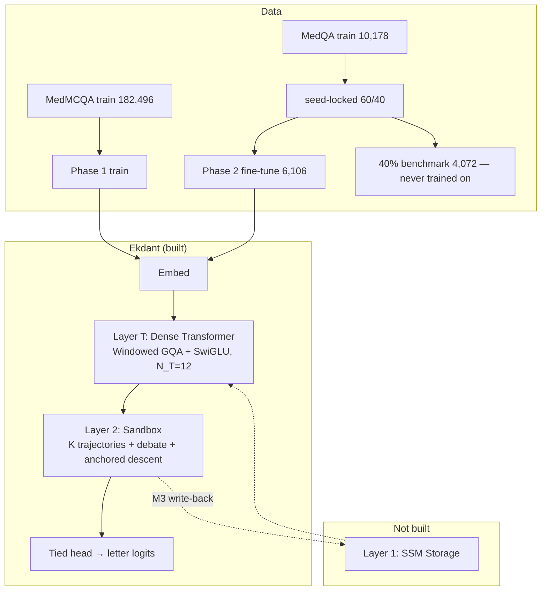

# 01 — Introduction: Problem, Idea, and Thesis Plan

> Thesis Ch. 1. Read next: `02` (method) → `19`/`20` (background papers) → `21`/`22` (how each layer works).

## 1. The problem

Large language models are almost synonymous with the Transformer decoder: alternating self-attention and MLP blocks trained with next-token prediction. That stack has three properties this thesis treats as limitations for its target use cases:

1. **Memory grows with sequence length.** Self-attention costs quadratic time and a KV-cache that grows linearly with context. Long documents — a large codebase, a multi-year record, a paper plus its references — are exactly what a reasoning model should handle, and exactly where attention is most expensive.
2. **One monolithic flow does everything.** A single stack must simultaneously scan the input, retrieve memory, structure reasoning, check its own answer, and emit text. These are separable jobs, and forcing one undifferentiated network to do all of them hides which part is responsible when reasoning fails.
3. **Confidence is a side effect, not a target.** Softmax probabilities fall out of the loss; they are not calibrated statements of certainty. A confident wrong answer is annoying in code and dangerous in high-stakes domains such as medicine. The model should be able to say what it knows, what it does not, and what else the answer could be.

## 2. The idea: Ekdant

Ekdant is designed as **two layers (L1 SSM Storage, L2 Sandbox) with a dense Transformer stack (T)** — no MoE, the sandbox debates instead. **What is built and evaluated is T + L2** (50.09M parameters, against an identical 43.53M baseline without L2), trained on medical multiple-choice QA. L1 is specified and left as future work.

- **Layer 1 — aSSM Storage (the memory answer; design only).** An *advanced* SSM: one shared projection trunk feeding **three selective stores** — content, control, and a sandbox channel. Training scans all stores in parallel in linear time; inference carries three fixed states — O(1), no KV-cache. In full: `21_Thesis_Ch3_Layer1_SSM_Storage.md`. Why it should work: `19_Thesis_Ch2_SSM_Storage_Papers.md`.
- **Layer 2 — Sandbox (the reasoning answer; built).** The backbone representation is expanded into K parallel trajectories that debate (read and revise each other) and descend toward an external anchor (energy refinement), then average into a consensus and project through the tied vocabulary head. Multiple live hypotheses replace single-path chain-of-thought, and trajectory agreement becomes an observable proxy for confidence. In full: `22_Thesis_Ch3_Layer2_Sandbox.md`. Why it should work: `20_Thesis_Ch2_Sandbox_Papers.md`.
- **Layer T — Dense Transformer (the retrieval answer; built).** N_T = 12 identical blocks of windowed GQA (window 512, KV bounded) + SwiGLU FFN. Restores exact local recall that a pure SSM compresses away, before reasoning begins.

The built forward pass (the full design adds `SSMStack` before T and the M3 write-back):

```
input_ids
 → embed
 → Transformer: hT = TransformerStack(x)            # 12 dense windowed blocks
 → Sandbox: trajectories = init_K(hT)               # sandbox arm only
            refined = debate → anchored_gated_descent(trajectories)
            y = consensus(refined)
 → logits = tied_head(ln_f(y))                      # one dense projection
```

Training signals: next-token cross-entropy, an optional answer-letter cross-entropy (`--answer-weight`, because the letter is 1 token in ~34–173), and — sandbox arm only — a spread floor `max(0, ρ_min − ρ)²` that fires only when the K hypotheses collapse (`ρ = trajectory_variance / mean(hT²)`). Notably *not* an agreement penalty, which would be minimized by the very collapse it is meant to prevent ([29](../04-Model-DeepDive/29_Prior_Art_and_Novelty_Check.md) §3.2).



## 3. Research questions and hypotheses

- **RQ1 (memory) — future work:** Can a fixed-size selective SSM state replace the KV-cache with linear-time training and constant-memory inference at matched quality? Needs L1; protocol pre-specified. *Ablations: d_state sizes; SSM vs. tiny-Transformer backbone at equal params; peak-memory vs. length curve.*
- **RQ2 (reasoning):** Does the K-trajectory sandbox beat the identical backbone without it on MedMCQA/MedQA letter accuracy? *Ablations: K = 1/4/8; debate rounds 0/2/3; descent steps 0/8; anchor vs peer-mean; a depth-/parameter-matched no-sandbox control.*
- **RQ3 (honesty signal):** Does trajectory agreement predict correctness — i.e., can the sandbox's consensus serve as a working confidence signal? *Measurement: agreement-vs-accuracy calibration on the benchmark rows (needs sandbox diagnostics persisted — open item).*

Success criteria for the thesis build (50M class, 1× T4 for the campaign, 32K vocab): loss decreases from scratch (tested); both arms run end to end with resume (done); the sandbox's effect on `medqa_bench` is measured with an honest error bar and reported even if it is a tie.

## 4. Contributions

1. A minimal three-stage design — **memory** (selective SSM, specified), **local retrieval** (windowed dense Transformer, built), **reasoning** (parallel sandbox, built) — with no MoE.
2. An in-graph debate + anchored energy-descent loop with consensus, with an audit showing the discarded peer-mean variant is inert, evaluated under cost-matched protocols.
3. A 66-paper local background library (`papers/`, indexed in `papers/00_Papers_Index.md`) mapping every design choice to its source.
4. A reproducible, leakage-free sequential training/benchmark pipeline on MedMCQA → MedQA, documented in `05`–`09`.

## 5. Scope

The thesis covers text-only training from scratch on MedMCQA and MedQA, letter-accuracy evaluation, and honesty-on-unknown probes. Tool use, multimodality, mixture-of-experts, SFT/DPO and general-purpose language modelling are outside scope. GSM8K, HumanEval and MMLU are scaling-held-out at 50M parameters (Known Issues T14).

## 6. How to read this vault (thesis map)

| Read | Gives you | Thesis chapter |
|------|-----------|----------------|
| `02_System_Architecture.md` | Method: the whole system | Ch. 3 |
| `19_Thesis_Ch2_SSM_Storage_Papers.md` + `papers/SSM_Storage/` | Background: why selective SSM | Ch. 2 §B |
| `20_Thesis_Ch2_Sandbox_Papers.md` + `papers/Sandbox_Reasoning/` | Background: why parallel sandbox | Ch. 2 §C |
| `21_Thesis_Ch3_Layer1_SSM_Storage.md` | L1 working in full detail (design) | Ch. 3 §1 |
| `22_Thesis_Ch3_Layer2_Sandbox.md` | L2 working in full detail | Ch. 3 §2 |
| `05_Data_Pipeline.md`, `09_Validation_System.md` | Data and validation | Ch. 4–5 |
| `12_Configuration_Guide.md` | Config knobs and training flags | Reproducibility |
| `07_Training_Pipeline.md` | Training phases and losses | Ch. 5 |
| `14_Performance_Analysis.md` | Cost and results tables | Ch. 6 |

## 7. Build status

| Component | Status |
|-----------|--------|
| Data pipeline (MedMCQA → MedQA, tokenizer, prompt/letter eval) | Implemented + tested (`09-Code/src/ekdant/data.py`) |
| L1 SSM storage | Designed (vault/thesis) — **not** in current code |
| T (`09-Code/src/ekdant/transformer_stack.py`) | Implemented + tested |
| L2 (`09-Code/src/ekdant/sandbox.py` + `output_head.py`) | Implemented + tested |
| Wiring + config (`model.py`; `configs/sandbox_50m.json` / `baseline_50m.json`) | Implemented (embed → T → L2 → head) |
| Training + evaluation (`train.py`) | Implemented: sequential protocol, resume, eval-only |
| Tests (`09-Code/tests/`) | **92 passing** (model, sandbox, transformer, data, LR schedule, benchmark split) |
| Pipeline-scale A/B (3 epochs, T4) | Done — a tie (see `STATUS.md`) |
| 100-epoch campaign | Prepared in `run.md` §3 — pending |
| Background library (66 PDFs) | Ready (`papers/00_Papers_Index.md`) |
