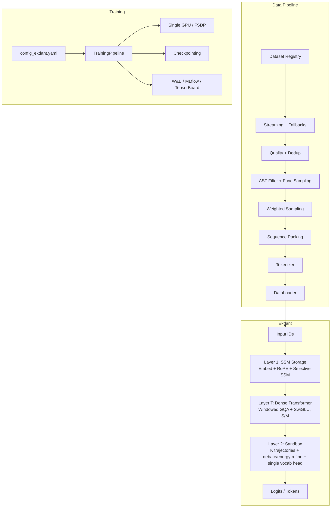

# 01 — Introduction: Problem, Idea, and Thesis Plan

> Thesis Ch. 1. Read next: `02` (method) → `19`/`20` (background papers) → `21`/`22` (how each layer works).

## 1. The problem

Large language models are almost synonymous with the Transformer decoder: alternating self-attention and MLP blocks trained with next-token prediction. That stack has three properties this thesis treats as limitations for its target use cases:

1. **Memory grows with sequence length.** Self-attention costs quadratic time and a KV-cache that grows linearly with context. Long documents — a large codebase, a multi-year record, a paper plus its references — are exactly what a reasoning model should handle, and exactly where attention is most expensive.
2. **One monolithic flow does everything.** A single stack must simultaneously scan the input, retrieve memory, structure reasoning, check its own answer, and emit text. These are separable jobs, and forcing one undifferentiated network to do all of them hides which part is responsible when reasoning fails.
3. **Confidence is a side effect, not a target.** Softmax probabilities fall out of the loss; they are not calibrated statements of certainty. A confident wrong answer is annoying in code and dangerous in high-stakes domains. The model should be able to say what it knows, what it does not, and what else the answer could be.

## 2. The idea: Ekdant

Ekdant joins **two layers (L1 SSM Storage, L2 Sandbox) with a dense Transformer stack (T)** — no MoE, the sandbox debates instead — at three sizes, **XS ≈12M**, **S ≈21M** and **M ≈46M**:

- **Layer 1 — aSSM Storage (the memory answer).** An *advanced* SSM: one shared projection trunk feeding **three selective stores** — content (what was said, for the model), control (what to do, for the model), and a sandbox channel (tracking + instructions, for L2). Training scans all stores in parallel in linear time; inference carries three fixed states — still O(1), no KV-cache. How it works in full: `21_Thesis_Ch3_Layer1_SSM_Storage.md` (triple math + fusion + feedback). Why it should work: `19_Thesis_Ch2_SSM_Storage_Papers.md` (S4 → Mamba lineage; multi-channel precedent: S5 MIMO, Mamba-2 heads).
- **Layer 2 — Sandbox (the reasoning answer).** L1's representation is expanded into K parallel trajectories that debate (read and revise each other) and descend toward consensus (energy refinement), then project through a single vocabulary head. Multiple live hypotheses replace single-path chain-of-thought, and trajectory agreement becomes an observable proxy for confidence. How it works in full: `22_Thesis_Ch3_Layer2_Sandbox.md`. Why it should work: `20_Thesis_Ch2_Sandbox_Papers.md` (20 papers, debate + energy lineage).
- **Layer T — Dense Transformer (the retrieval answer).** N identical blocks (S: 5, M: 6) of windowed GQA (window 512, KV bounded) + SwiGLU FFN. Restores exact local recall that pure SSM compresses away, before reasoning begins.

The full forward pass:

```
input_ids
 → embed + RoPE
 → SSM Storage: h = SSMStack(x)                       # O(1) state, linear time
 → Transformer: hT = TransformerStack(h)            # N identical dense blocks (S: 5, M: 6)
 → Sandbox: trajectories = init_K(hT)
            refined = debate_or_energy_descent(trajectories)
            y = consensus(refined)
 → logits = vocab_head(y)                              # one dense projection
```

Two training signals: next-token cross-entropy (`lm_ce`) and a spread floor `max(0, ρ_min − ρ)²` that fires only when the K hypotheses collapse (`ρ = trajectory_variance / mean(hT²)`). Nothing else — notably *not* an agreement penalty, which would be minimized by the very collapse it is meant to prevent ([29](../04-Model-DeepDive/29_Prior_Art_and_Novelty_Check.md) §3.2).



## 3. Research questions and hypotheses

- **RQ1 (memory):** Can a fixed-size selective SSM state replace the KV-cache with linear-time training and constant-memory inference at matched quality? *Ablations: d_state sizes; SSM vs. tiny-Transformer backbone at equal params; peak-memory vs. length curve.*
- **RQ2 (reasoning):** Do K parallel trajectories with debate + consensus beat single-path decoding on reasoning tasks at matched compute? *Ablations: K = 1/4/8; debate rounds 0/2/3; energy steps 0/8; T blocks (S: 5, M: 6), window 256/512, S-vs-M width study; matched-budget comparison against self-consistency.*
- **RQ3 (honesty signal):** Does trajectory agreement predict correctness — i.e., can the sandbox's consensus serve as a working confidence signal? *Measurement: agreement-vs-accuracy calibration on GSM8K/HumanEval samples.*

Success criteria for the thesis build (XS ≈12M / S ≈21M / M ≈46M, 1× A100, 32K vocab, 50K steps): loss decreases from scratch; `compressed` state shape and peak memory flat across lengths (O(1) proof); sandbox K > 1 beats K = 1 at matched FLOPs on reasoning samples.

## 4. Contributions

1. Our two layers — **memory** (selective SSM) and **reasoning** (parallel sandbox) — joined by a **dense Transformer stack** (windowed GQA + SwiGLU, no MoE), built at S ≈21M and M ≈46M.
2. An in-graph debate + energy refinement loop with consensus, evaluated under cost-matched protocols.
3. A 66-paper local background library (`papers/`, indexed in `papers/00_Papers_Index.md`) mapping every design choice to its source.
4. A production-grade data pipeline (registry → streaming → quality → packing) that feeds the model and is documented in `05`–`09`.

## 5. Scope

The thesis covers text-only pretraining (plus optional SFT/DPO), five evaluation benchmarks (HumanEval, GSM8K, MMLU, HellaSwag, ARC), and honesty-on-unknown probes. Tool use, multimodality, and mixture-of-experts are outside scope.

## 6. How to read this vault (thesis map)

| Read | Gives you | Thesis chapter |
|------|-----------|----------------|
| `02_System_Architecture.md` | Method: the whole system | Ch. 3 |
| `19_Thesis_Ch2_SSM_Storage_Papers.md` + `papers/SSM_Storage/` | Background: why selective SSM | Ch. 2 §B |
| `20_Thesis_Ch2_Sandbox_Papers.md` + `papers/Sandbox_Reasoning/` | Background: why parallel sandbox | Ch. 2 §C |
| `21_Thesis_Ch3_Layer1_SSM_Storage.md` | L1 working in full detail | Ch. 3 §1 |
| `22_Thesis_Ch3_Layer2_Sandbox.md` | L2 working in full detail | Ch. 3 §2 |
| `05`–`09` | Data pipeline and validation | Ch. 4–5 |
| `12_Configuration_Guide.md` | All ~13 knobs | Reproducibility |
| `07_Training_Pipeline.md` | Training stages and losses | Ch. 5 |
| `14_Performance_Analysis.md` | Cost and results tables | Ch. 6 |

## 7. Build status

| Component | Status |
|-----------|--------|
| Data pipeline, registry, doc builder, validation harness | Ready |
| L1 SSM storage | Designed (vault/thesis) — **not** in current code |
| T (`09-Code/src/ekdant/transformer_stack.py`) | Implemented + tested |
| L2 (`09-Code/src/ekdant/sandbox.py` + `output_head.py`) | Implemented + tested |
| Wiring + config (`09-Code/src/ekdant/model.py`; `configs/sandbox_50m.json` / `baseline_50m.json`) | Implemented (L2-only forward: embed → T → L2 → head) |
| Tests (`09-Code/tests/`: `test_model.py`, `test_sandbox.py`, `test_transformer.py`, `test_data.py`, `test_schedule.py`, `test_eval_split.py`) | **85 passing** (model, sandbox, transformer, data-schema, LR-schedule, benchmark half-split, answer-weight unit tests) |
| Background library (66 PDFs) | Ready (`papers/00_Papers_Index.md`) |
