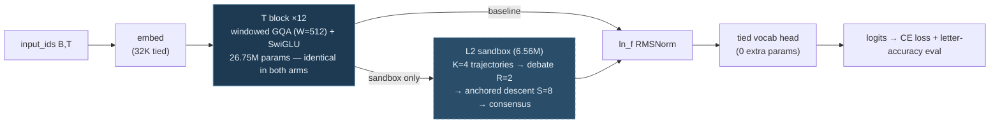
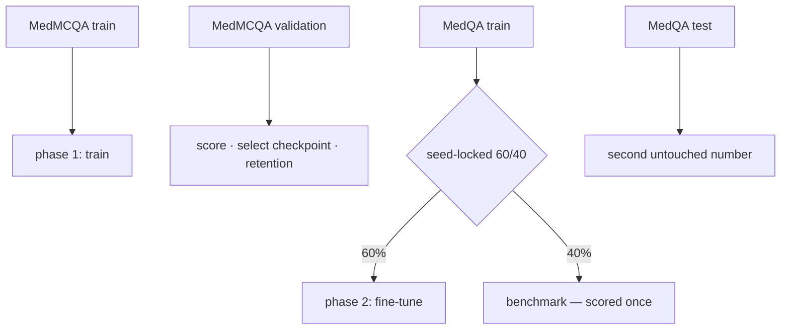
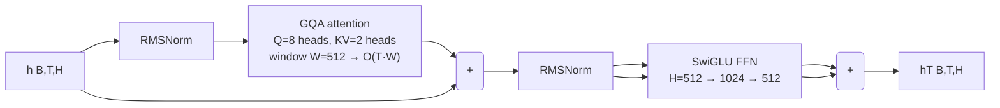
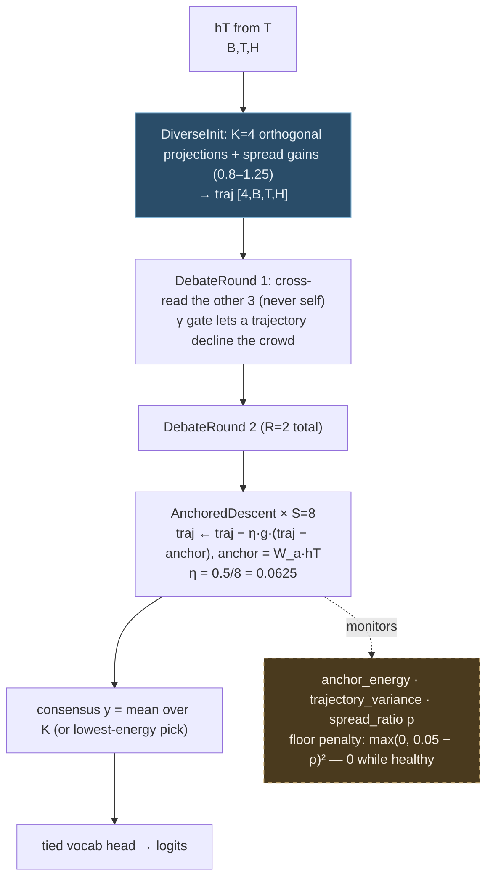

# 02 — System Architecture: How Ekdant Works (canonical)

> Canonical method spec — Ch. 3. If any other file disagrees, this file wins.
> Detail pages: [L1](../04-Model-DeepDive/21_Thesis_Ch3_Layer1_SSM_Storage.md) · [L2](../04-Model-DeepDive/22_Thesis_Ch3_Layer2_Sandbox.md). Background: [L1](../03-Background/19_Thesis_Ch2_SSM_Storage_Papers.md) · [L2](../03-Background/20_Thesis_Ch2_Sandbox_Papers.md).
> Companions: shipped API → [API_Reference.md](API_Reference.md) · codebase map → [03](03_Codebase_Map.md) · knobs → [12](12_Configuration_Guide.md). §9–§14 absorb the former complete build+test spec and internal build plan.

## 0. v2 — the current build (pretrained backbone + gated add-on)

> [!important] **v2.1 (current, T35):** L2 now sits **after decoder layer 20 of 30**, so layers 21–30 and, through attention, later tokens read its output — an extension beyond the design, in which L2 is an independent final stage (T38). The diagram and table below describe v2.0 (L2 after the final norm, a dead end), which tied.
>
> ```
> v2.1 (current):  ids ─► SmolLM2 layers 1–20 ─► h ─► h + g ⊙ RMSNorm(L2(RMSNorm(h))) ─► layers 21–30 ─► final norm ─► lm_head
> v2.0 (the tie):  ids ─► SmolLM2 layers 1–30 ─► final norm ─► h ─► h + g ⊙ (RMSNorm(L2(h)) − h) ─► lm_head
> ```
>
> Mid formula `h + g ⊙ RMSNorm(L2(RMSNorm(h)))` (the stream there has rms ≈ 103, outliers ≈ 2×10⁴); gate LR 1e-3, L2 matrices 1e-4; add-on 19,595,520 params; 2 PubMedQA epochs. Spec 30 §13.

> [!important] **v2 is what the thesis now evaluates** ([spec](../07-Management/30_Design_v2_Pretrained_Backbone.md), [T28](../07-Management/10_Known_Issues.md)). Sections 1–13 describe the full three-stage design and the v1 from-scratch build (`--task mcq`), which is kept for reproducibility.

```
input ids ─► SmolLM2-135M (30 layers, H=576, 9 heads / 3 KV, vocab 49,152, tied head)
           ─► last hidden state h                      [B,T,576]
           ─► add-on: h' = h + g ⊙ (RMSNorm(f(h)) − h)          g ∈ R^576, g = 0 at init
           ─► SmolLM2 lm_head (tied)                   logits [B,T,49,152]
```

| arm (`--variant`) | `f(h)` | added params | total |
|---|---|---|---|
| `baseline` | — (`h' = h`) | 0 | 134,515,008 |
| `sandbox` | L2 consensus: K=4, **R=4 debate rounds, debate MLP 4×**, S=8 anchored descent (η=0.0625), mean readout | 19,594,944 | 154,109,952 |

- **Output norm (T32):** the L2 consensus is RMS-normalised before the gate. `h` is already past SmolLM2's final norm and goes straight to the head, so an unnormalised L2 output grew the logits without bound (first sandbox run: loss in the thousands, gradient norm 10¹¹ → ∞). v1 had `ln_f` after L2 for the same reason.
- **Pre-norm in every debate round (T33):** each round reads `RMSNorm(traj)`, so weight growth cannot compound across the ~14 chained matrices (unnormalised, the consensus grew 0.7 → 36,560 in 180 training steps). v1 keeps the old rounds (`norm_inputs=False`).
- **Zero-init gate:** both arms produce the backbone's exact logits at step 0, so any later difference comes from training the add-on. `|g|` (mean absolute gate) is logged; it shows whether the model uses the add-on.
- **L2 scaled to the model:** v1's L2 was 13.1 % of its model (6.56M of 50.09M); at R=4 / 4× the v2 L2 is 12.7 %. The old R=2 / 2× setting would be only 8.30M (5.8 %).
- **Architecture-matched, not parameter-matched:** the sandbox arm has +19.59M parameters and more compute per token, so a gain could come from capacity; a same-size control is future work (it was removed from v2 on 2026-10-23).
- **Loss:** next-token CE on **answer tokens only** + the spread floor `λ_sbx · relu(ρ_min − ρ)²` (sandbox arm; ρ over answer tokens).
- **Generation:** L2 mixes trajectories within one position only, so decoding reuses the backbone's KV cache and applies the add-on to each new token (tested).
- Code: `backbone.py` (load SmolLM2, offline-first, cast to float32), `model.py` (`V2Config`, `GatedAddOn`, `EkdantLM`), `gen_data.py`, `gen_eval.py`, `train_gen.py`. Runbook: [run.md](../run.md) Part A.

## 1. System at a glance

> [!important] **L1 and L2 are independent stages (T38).** L1 is SSM memory in front of T, L2 a reasoning stage after it; nothing flows from L2 back into L1 (the earlier M3 write-back was removed). L1's third store is the **task store** `S^task`.

Three subsystems. The model subsystem is the thesis contribution; the other two are the apparatus that feeds and judges it.

> **Implemented vs. designed:** the runnable code lives at `09-Code/src/ekdant/` — 7 modules (`model`, `transformer_stack`, `sandbox`, `output_head`, `train`, `data`, `__init__`), the **T + L2 build** (`embed → T → L2 → head`, N_T=12, A/B configs in `09-Code/configs/*.json`). L1 (`ssm_storage.py`, §3, `21`) is **specified here but not built** and independent of L2 (no write-back, T38); every L1 statement is design, not result.

**Data** (`ekdant.data`): MedMCQA, then MedQA, rendered as one prompt template with the answer letter as the target; a shared BPE tokenizer; a seed-locked 60/40 MedQA partition. Documented in [05](../05-Data/05_Data_Pipeline.md).

**Model** — the shipped package (`09-Code/src/ekdant/`, T + L2, no L1) is the **7-module layout** below; the forward pass is `embed → T → L2 → head` (N_T=12, A/B configs in `09-Code/configs/*.json`):

| Module (shipped) | Responsibility |
|------|----------------|
| `model.py` | `EkdantConfig` (plain dataclass), `EkdantModel` (plain `nn.Module`), `ModelOutput` — embed → T → L2 → head wiring, LM CE + answer-letter CE + spread-floor loss, `score_options`, `estimate_model_size`, `baseline_config` |
| `transformer_stack.py` | T: N identical dense blocks — windowed GQA + SwiGLU, no MoE (shipped A/B: N_T=12; design sizes S: 5, M: 6) |
| `sandbox.py` | L2: K trajectories, cross-read debate, anchored gated descent, consensus + aux monitors |
| `output_head.py` | head: single tied `hidden → vocab` projection (0 extra parameters) |
| `train.py` | entrypoint `python -m ekdant.train --variant sandbox\|baseline` (sequential: MedMCQA → test → MedQA 60% fine-tune → 40% benchmark) |
| `data.py` | MedMCQA/MedQA MCQ pipeline (prompt template, letter-token eval) |
| `__init__.py` | re-exports |

**The shipped forward pass (T + L2 (no L1) build), with the A/B switch** — both
variants share every box; the dashed path exists only when
`use_sandbox = true`:



**Param accounting (why the A/B is architecture-matched, not
parameter-matched):** backbone = embed 16.78M + T 26.75M + head 0 =
43.53M for **both** arms; the sandbox arm *adds* L2 = 6.56M → 50.09M.
The imbalance (+15%) favors the sandbox, so a tie (or a loss) is
conservative evidence; a param-matched *depth-matched control* (same
50.09M, no L2, more untied depth instead) is the third arm that makes a
"gain" claim airtight ([11](../07-Management/11_Future_Work.md)).

The **full design** adds L1 `ssm_storage.py` (§3 — selective SSM stack, design-only, not in the package) ahead of T; the design target is 5 model files (L1 → T → L2 → head + model). Full shipped signatures: [API_Reference.md](API_Reference.md).

**Transformer components (first-class, not an afterthought):** RoPE positional injection in L1 (`rope_theta`) and cross-trajectory attention in the L2 debate rounds. Attention is used *inside* subsystems for positioning and cross-reading — never as the top-level stack, and never over the sequence length (cost scales with K ≤ 8) — so inference stays O(1) in T.

**Training and evaluation** (`ekdant.train`): one invocation runs the sequential protocol — phase 1 on all of MedMCQA, phase 2 fine-tune on 60 % of MedQA, then the untouched 40 % benchmark and the official MedQA test — with resume, `--eval-only`, and checkpoint selection on the untouched MedMCQA validation split. Details in [07](../06-Training-Eval/07_Training_Pipeline.md), [09](../06-Training-Eval/09_Validation_System.md), [14](../06-Training-Eval/14_Performance_Analysis.md).

## 2. Data flow into the model

Two public datasets, strictly in sequence ([05](../05-Data/05_Data_Pipeline.md)): MedMCQA (182,496 labelled train rows; 4,183-row validation split, 4,170 usable after the row filters, used for selection and retention) then MedQA (10,178 train rows → seed-locked 60 % fine-tune / 40 % untouched benchmark; 1,273 official test rows). Each example is `question + A–D options + "Answer:"` with the answer letter as the target; a BPE tokenizer (configured for 32,768 entries; it learns 26,766 on the 20,000-prompt sample) trained once on MedMCQA prompts is shared by both arms; batches pad to the batch maximum (p99 118 / 364 tokens, nothing truncated).



## 3. Layer 1 — SSM Storage: the memory answer

**Problem it solves (§1.1):** attention memory grows with sequence length. L1 replaces it with a fixed-size recurrent state.

**How:** `input_ids [B,T]` → tied embedding `[B,T,H]` + RoPE (Transformer positional component) → a stack of `n_ssm_layers` aSSM blocks (shared trunk + 3 selective stores each). Each block makes its dynamics input-dependent (Δ/B/C from the input), updates a state of dimension `d_state` by associative scan in linear time, and gates the result with a residual connection. Output is `h [B,T,H]` plus an optional pooled triple `compressed [B,3·d_state]`, handed to the Transformer layer (T). Inference carries the fixed state forward — memory is constant in sequence length, with no KV-cache. Full derivation, shapes, ablations, and the O(1) proof protocol live in `21_Thesis_Ch3_Layer1_SSM_Storage.md`.

**Why this design:** static state-space models compress well but cannot selectively forget; input-dependent selection fixes copying and induction (the Mamba result). Diagonal parameterization keeps it simple and stable; HiPPO initialization gives the long-range memory its theory. The known price — weaker exact recall than attention — is covered by the Transformer layer (T) below; full-sequence global attention stays out of scope. Sources: `19`, PDFs `papers/SSM_Storage/B1`, `B2`, `B5`, `B6`, `B11`, `B12a`, `B13`, `B20`.

## 4. Layer T — Dense Transformer stack: the retrieval answer

**Problem it solves:** L1's compressed state is lossy on exact recall (Vault B11). T restores precise local retrieval before reasoning begins — with plain dense blocks. No MoE: the sandbox (K debating trajectories) is this architecture's mixture mechanism, so a router would duplicate it and risk collapse at this scale.

**How:** `h [B,T,H]` → `n_transformer_layers` identical blocks (XS: 3, S: 5, M: 6; shipped A/B: **12**). Each block: pre-norm → windowed GQA (`transformer_window` = 512, RoPE shared base — KV bounded by W, never T) → residual → pre-norm → dense SwiGLU FFN → residual. Output `hT [B,T,H]` feeds L2.



(Pre-norm topology: the block's input skips to each `+`; shown via the two parallel arrows into `R1`/`R2`.)

**Why this design:** exact-recall results (B11/Jamba) show pure SSM trails attention; a bounded window buys back recall at fixed memory cost. Cost is O(T·W) attention plus dense FFN — bounded, never T².

**Why dense Transformer is the best backbone for testing L1+L2:** at 10–40M and 2K context, dense attention is cheap, exact, and debuggable — exotic blocks (Mamba-2 SSD, Gated DeltaNet, Kimi Delta Attention) only pay off at long context and large scale, need custom kernels (breaking the internal-only rule), and would confound attribution. The backbone must be *standard* so every measured gain belongs to an added layer. The experiment is a ladder, always cost-matched: backbone-only → +L1 → +L1+L2, on recall probes and reasoning samples.

## 5. Layer 2 — Sandbox: the reasoning answer

**Problem it solves (§1.2–1.3):** one monolithic pass hides who reasons, and its confidence means nothing. L2 expands L1's output into K diverse trajectories that read and revise each other (debate rounds), descend toward agreement (energy steps), and vote a consensus that is projected to logits. Agreement across trajectories is observable per example — the working confidence signal.

**How:** `hT` (Transformer-enhanced) → K diverse initializations `trajectories [K,B,T,H]` → `n_debate_rounds` of cross-trajectory attention and revision → `sandbox_steps` of anchored gated descent toward the token-conditioned anchor `a_t = W_a·hT_t` (a pull toward the running consensus is provably inert on the readout — see [29](../04-Model-DeepDive/29_Prior_Art_and_Novelty_Check.md) §3.1) → consensus `y` (mean, or lowest-energy pick) → `logits = output_head(y)`, one dense projection per micro-batch. Full protocol, cost-matched evaluation rules, and failure modes (false consensus, collapse, cost > gain) live in `22_Thesis_Ch3_Layer2_Sandbox.md`.



**The A/B question this diagram answers:** the sandbox arm pays
(1) +6.56M params, (2) 4× projection work per token, (3) 2 debate rounds
+ 8 descent steps — to produce *one* consensus vector per position that
replaces `hT` before the head. If the final numbers tie (they do in the
3-epoch pilot, and the 100-epoch campaign is pending), the claim under test is
whether any of that machinery ever beats the plain backbone at this scale.

**Why this design:** single-path chain-of-thought is the control; sampling K paths and voting (self-consistency) is the matched-budget baseline; in-graph debate plus latent energy refinement is the tested improvement — with the published critique that debate often ties voting at equal cost built into the evaluation rules rather than hidden. Sources: `20`, PDFs `papers/Sandbox_Reasoning/C1`, `C2`, `C3`, `C8`, `C11`.

## 6. Training signals

- `lm_ce` (weight 1.0): standard causal next-token cross-entropy on shifted logits.
- Answer-letter CE (`--answer-weight`, default 0, campaign 10): `CE(logits[answer_pos − 1], answer_letter)`. The letter is 1 token in ~34 (MedMCQA) / ~173 (MedQA), so plain LM CE gives the scored decision ~1–3 % of its gradient (T22). Applied to both arms.
- Spread floor (sandbox arm only; shipped `lambda_sbx = 1.0`, design value 0.1; threshold `rho_min = 0.05`): `max(0, ρ_min − ρ)²` on the dimensionless ratio `ρ = trajectory_variance / mean(hT²)`. Zero while the K hypotheses keep their spread, positive only on collapse. Reported and never minimized: `anchor_energy`, `trajectory_variance`, `spread_ratio`. A bare agreement penalty is deliberately **not** used — it is minimized by the collapse it is meant to prevent ([29](../04-Model-DeepDive/29_Prior_Art_and_Novelty_Check.md) §3.2).

## 7. Configuration (`EkdantConfig`)

Shipped fields: `vocab_size`, `dim`, `n_t`, `n_heads`, `n_kv_heads`, `window`, `ffn_hidden`, `max_seq_len`, `pad_id`; L2: `use_sandbox`, `n_sandbox` (K), `debate_rounds`, `descent_steps`, `eta`, `rho_min`, `lambda_sbx`, `readout` (`mean` | `lowest_energy`); `dropout`. Values and meanings in [12](12_Configuration_Guide.md); the two JSONs differ only in `use_sandbox`. The L1 knobs (`d_state`, `n_ssm_layers`) and the XS/S/M design sizes (§11) belong to the full design.

```mermaid
graph TB
    subgraph "Ekdant forward"
        IN[Input IDs] --> EMB[Embed + RoPE<br/>(Transformer pos.)]
        EMB --> SSM[SSM Storage x N<br/>O(1) state]
        SSM --> TR[T: Dense Transformer<br/>windowed GQA + SwiGLU]
        TR --> SB[Sandbox: K trajectories<br/>cross-attention debate + energy refine]
        SB --> CON[Consensus]
        CON --> HEAD[Single vocab head]
        HEAD --> OUT[Logits]
    end
```

## 8. Running it

The runnable workflow lives in `09-Code/` (the T + L2 (no L1) build; `pip install -e .` first). From `09-Code/`:

- **Unit tests:** `pytest -q` — 193 tests in `tests/test_model.py`, `tests/test_sandbox.py`, `tests/test_transformer.py`, `tests/test_data.py`, `tests/test_schedule.py`, `tests/test_eval_split.py` (forward shapes, A/B config match, gradient flow, spread floor, data schemas, LR schedule, benchmark 60/40 partition, answer-weight loss). Ops runbook: [`run.md`](../run.md).
- **Train (single GPU):** `python -m ekdant.train --variant sandbox --out runs/sandbox` or `python -m ekdant.train --variant baseline --out runs/baseline` — **sequential protocol in one invocation: (1) train on all of MedMCQA → record the MedMCQA validation result (`phase1`), (2) fine-tune on a seed-locked 60% partition of MedQA train, (3) benchmark the complementary 40% exactly once + the official MedQA test (also untouched)**; the untouched MedMCQA validation set drives per-epoch `best.pt` selection, and the final checkpoint is the better of `best.pt` vs `last.pt` on that validation set (recorded in `selected`). Live telemetry every `--log-every` (default 100) optimizer steps — step/total, % of phase, EMA loss, LR, grad norm, tok/s, ETA — plus per-epoch summaries, `--eval-every` validation evals, and `history[loss,lr,gnorm,test]` in `results.json` (`test{medmcqa_val, medqa_bench, medqa_test}` + `phase1` + `selected`). **Current recipe: `--epochs 2 --batch-size 6 --grad-accum 8 --ft-lr 5e-5 --ft-epochs 10 --answer-weight 10`** (phase-1 validation peaks at epoch 1, T25) — 8,884 optimizer steps; the older 100-epoch campaign was 381,480 (the `--ft-*` knobs cap the 6,106-row fine-tune — T21; `--answer-weight` re-weights the 1-token answer-letter CE that plain LM loss dilutes ~97–99% — T22); measured 6.3 opt steps/s on a T4 (the collator pads to batch max; measured p50 34 MedMCQA / 173 MedQA tokens, max 857, 0 rows exceed 2048) for 100 epochs ≈ **17.3 h baseline + ~26 h sandbox**; the 2-epoch recipe took ~45 min (baseline) on a shared 80 GB GPU (scale table, protocol, eval semantics, and progress-line glossary in [`run.md`](../run.md) §3).
- **Train (multi-GPU):** `torchrun --nproc_per_node=4 -m ekdant.train --variant sandbox --out runs/sandbox` (one variant at a time). Configs: `configs/sandbox_50m.json`, `configs/baseline_50m.json` (identical architecture; only `use_sandbox` differs; both seq 2048).

There is no `main.py`, `scripts/` directory or YAML size config; the commands above are the whole interface.

## 9. End-to-end pipeline (complete spec)

Thesis target (L1 + T + L2), shapes at defaults, batch B:

```
input_ids [B,T]
 → embed (tied V×H) + RoPE (base 100K)                        [B,T,H]
 → L1 aSSM ×N (shared trunk + 3 stores; d per size — §11)    h [B,T,H] + compressed [B,3·d]   (DESIGN-ONLY)
 → T dense blocks (windowed GQA W=512 + SwiGLU)              hT [B,T,H]   (KV ≤ 512; S: 5, M: 6)
 → L2: init_K → [4,B,T,H] → debate ×2 → descent ×8
 → consensus y [B,T,H] + variance report
 → vocab head (tied) → logits [B,T,V]
loss = CE(shift(logits), shift(labels)) + answer_weight · CE(answer letter) + lambda_sbx · max(0, rho_min − spread_ratio)²
```

Shipped (T + L2, no L1 — what runs today): the same pipeline minus the L1 row — `embed → T (N_T=12) → L2 → head`, seq 2048 (shipped-config value, matching the thesis spec; the `EkdantConfig` dataclass default remains 1024), configs `09-Code/configs/*.json`.

Generate mode (design): carry L1 fixed state + T window KV (≤512 entries) + run the sandbox per generated token; sample with temperature/top-k/top-p.

## 10. File-by-file build (thesis target, 5 model files)

The shipped package is the 7-module layout in §1; the thesis build target is these 5 files plus the training/data apparatus:

| File | Build |
|---|---|
| `model.py` (~200) | `EkdantConfig` (~13 thesis fields, §11) + `EkdantModel` wiring L1→T→L2→head + `EkdantForCausalLM` wrapper + `generate()` loop |
| `ssm_storage.py` (~200, **DESIGN-ONLY**) | Embed + RoPE + N selective blocks (XS: 2, S/M: 4): project Δ/B/C → discretize → cumsum scan (train) / state recur (generate) → SiLU gate → residual → RMSNorm. Full recipe → [26a](../04-Model-DeepDive/26a_Internal_SSM_Build.md) |
| `transformer_stack.py` (~150) | T: N identical dense blocks — windowed GQA (W=512) + SwiGLU; XS: 3, S: 5, M: 6. Full recipe → [26b](../04-Model-DeepDive/26b_Dense_Transformer_for_T.md) |
| `sandbox.py` (~200) | Orthogonal-distinct init_K → debate ×2 (cross-read + repair gate) → descent ×8 (η≈0.5/S toward the anchor) → consensus + variance. Full recipe → [26c](../04-Model-DeepDive/26c_Internal_Sandbox_Build.md) |
| `output_head.py` (~40) | Single `Linear(H→V, bias=False)`, tied (XS: 32K×256, S: 32K×320, M: 32K×512); one dense projection per micro-batch |

## 11. Design-time size table (full three-stage model with L1; superseded by the shipped 50M A/B for every result)

| Parameter | XS | S | M | Notes |
|---|---|---|---|---|
| `hidden_size` / `vocab_size` / `max_position_embeddings` | 256 / 32768 / 4096 | 320 / 32768 / 4096 | 512 / 32768 / 4096 | Width, vocab, window |
| `rope_theta` / `tie_word_embeddings` | 100K / true | 100K / true | 100K / true | Scaled RoPE base; tied head |
| `d_state` / `n_ssm_layers` | 96 / 2 | 128 / 4 | 256 / 4 | L1 bottleneck + depth (design) |
| `n_transformer_layers` | 3 | 5 | 6 | T dense blocks |
| `transformer_window` | 512 | 512 | 512 | KV bounded by W |
| GQA heads / FFN I | 8Q+2KV (dim 32) / 512 | 8Q+2KV (dim 40) / 640 | 8Q+2KV (dim 64) / 1024 | Derived from width |
| `n_sandbox_paths` / `n_debate_rounds` / `sandbox_steps` | 4 / 2 / 8 | 4 / 2 / 8 | 4 / 2 / 8 | K, debate, anchored gated descent |
| `lm_weight` / `sandbox_weight` / `sandbox_rho_min` | 1.0 / 0.1 / 0.05 | 1.0 / 0.1 / 0.05 | 1.0 / 0.1 / 0.05 | The only two losses: LM CE + spread floor `max(0, ρ_min−ρ)²` |
| `training`: steps / lr / warmup / batch×accum | 50000 / 1e-4 cosine / 3000 / 4×4 (eff 16) | same | same | AdamW fused, wd 0.1, clip 1.0, BF16, `strategy: none` |

## 12. Param budget (design-time estimate, full model)

Embeddings tied (XS 8.4M · S 10.5M · M 16.8M) + L1 aSSM (1.5M / 4.8M / 13M) + T (1.7M / 4.4M / 13.4M) + L2 (0.8M / 1.3M / 2.8M) + head tied (0) + counting buffers (~0) = **XS 12.4M → S 21.0M → M 46.0M**. The L2 figure includes the diverse init, the R=2 debate nets, and the anchor `W_a [H,H]` plus gate `W_g [2H,H]`; it rose from 0.6/1.0/2.2M when the peer-mean pull was replaced by anchored gated descent. Round to **12M / 21M / 46M**.

Shipped reality check (measured, `09-Code`): at N_T=12 the A/B comes to **sandbox 50.09M / baseline 43.53M** (embed 16.78M + T 26.75M + L2 6.56M measured vs 2.8M thesis estimate — open item in `09-Code/README.md`; architecture-matched, only `use_sandbox` differs).

## 13. Test plan

Shipped tests live at `09-Code/tests/` (`test_model`, `test_sandbox`, `test_transformer`, `test_data`, `test_schedule`, `test_eval_split` — 193 passing; see [09](../06-Training-Eval/09_Validation_System.md)). The table is the thesis L1+T+L2 test plan; L1 rows are design-only (L1 not in the current package).

| Test | Proves (spec §) |
|---|---|
| Forward shapes (all 5 files) | §9–10 wiring |
| Grads reach L1 Δ/B/C, T, all K paths | §10 internals |
| Import-guard: no `mamba-ssm`/`causal-conv1d`/`flash-attn`/agent pkgs | Internal-only rule (§14) |
| O(1): same `compressed` shape + flat peak memory @512/2048/4096, KV ≤ 512 | §9 memory claims |
| K=1 vs 4 + T depth/window + S-vs-M + loss decrease | RQ1/RQ2 ([01](../01-Introduction/01_Project_Overview.md) §3) |
| Backbone-only → +L1 → +L1+L2, matched params/FLOPs | Proves each layer earns its place ([11](../07-Management/11_Future_Work.md)) |
| Variance/spread floor (collapse = fail) | Honesty guards |
| Smoke run per arm: train → resume → eval-only | [07](../06-Training-Eval/07_Training_Pipeline.md) §5 |

## 14. Internal-only build rule

**Internal-first:** L1, T, and L2 are implemented in-house with PyTorch core ops only — no third-party kernels or agent frameworks. Why: the official `mamba-ssm` stack needs Linux + NVIDIA GPU + CUDA + a `causal-conv1d` compiler build (kills single-machine debugging, MPS/CPU smoke runs, reproducibility); external multi-agent frameworks (AutoGen, CrewAI, LangGraph) run debate as text transcripts between separate models — the opposite of the in-graph, cost-matched design. Defense rule: if the examiner asks "show me the scan / the debate step," the answer is a file in this repo, not a package version. L1 recipe (project Δ/B/C → discretize → cumsum scan / state recur → gate+residual+norm) verified against Mamba Algorithm 2 shapes, not package numerics — [26a](../04-Model-DeepDive/26a_Internal_SSM_Build.md).

| Allowed (PyTorch core + boring deps) | Blocked for L1/T/L2 (thesis build) |
|---|---|
| `torch` (incl. SDPA), `einops`-free code preferred | `mamba-ssm`, `causal-conv1d`, `flash-attn`, `triton` kernels |
| `transformers` `>=4.45,<5` (v2: loads the pretrained SmolLM2-135M backbone; pinned for the pod's PyTorch 2.2.2, T30), `datasets`, `tokenizers` | AutoGen / CrewAI / LangGraph / any agent framework |
| `numpy` | Pretrained SSM weights (L1/T/L2 are built here; only the v2 backbone is pretrained) |

CI guard: `test_model_has_no_blocked_imports` and `test_no_blocked_imports_in_ekdant_package` assert no blocked import inside `src/ekdant/`; the shipped package contains none — every kernel is pure PyTorch.
