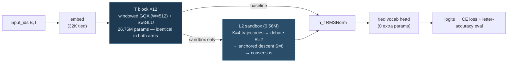
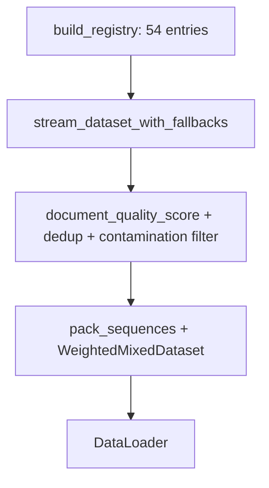
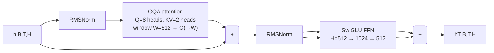
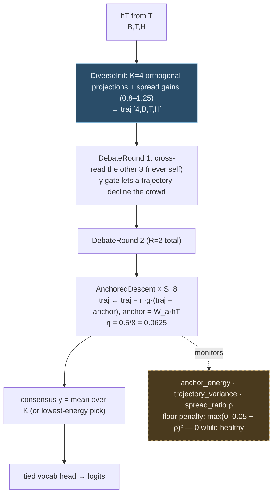

# 02 — System Architecture: How Ekdant Works (canonical)

> Canonical method spec — Ch. 3. If any other file disagrees, this file wins.
> Detail pages: [L1](../04-Model-DeepDive/21_Thesis_Ch3_Layer1_SSM_Storage.md) · [L2](../04-Model-DeepDive/22_Thesis_Ch3_Layer2_Sandbox.md). Background: [L1](../03-Background/19_Thesis_Ch2_SSM_Storage_Papers.md) · [L2](../03-Background/20_Thesis_Ch2_Sandbox_Papers.md).
> Companions: shipped API → [API_Reference.md](API_Reference.md) · codebase map → [03](03_Codebase_Map.md) · knobs → [12](12_Configuration_Guide.md). §9–§14 absorb the former complete build+test spec and internal build plan.

## 1. System at a glance

Four subsystems. The model subsystem is the thesis contribution; the other three are the apparatus that feeds, trains, and judges it.

> **Implemented vs. designed:** the runnable code in this vault lives at `09-Code/src/ekdant/` — 7 modules (`model`, `transformer_stack`, `sandbox`, `output_head`, `train`, `data`, `__init__`), currently the **L2-only build** (`embed → T → L2 → head`, N_T=12, A/B configs in `09-Code/configs/*.json`). Everything below is the thesis-target design (Ch. 3–6): `src/data/`, `src/models/factory.py`, `src/training/`, `src/infrastructure/`, `src/evaluation/`, `scripts/`, and the L1 module `ssm_storage.py` are specified here but are **not files in this vault**. L1 stays fully documented as design (§3, `21`).

**Data** (`src/data/`, 12 modules — thesis design; the shipped package carries a slimmer `ekdant.data` MedMCQA→MedQA MCQ pipeline): registry → streaming with fallbacks → quality scoring and deduplication → AST-based code filtering → weighted sampling → sequence packing → tokenizer → DataLoader. Documented in `05`–`09`; the most mature part of the codebase.

**Model** — the shipped package (`09-Code/src/ekdant/`, L2-only) is the **7-module layout** below; the forward pass is `embed → T → L2 → head` (N_T=12, A/B configs in `09-Code/configs/*.json`):

| Module (shipped) | Responsibility |
|------|----------------|
| `model.py` | `EkdantConfig` (plain dataclass), `EkdantModel` (plain `nn.Module`), `ModelOutput` — embed → T → L2 → head wiring, LM CE + spread-floor loss, `score_options`, `estimate_model_size`, `baseline_config` |
| `transformer_stack.py` | T: N identical dense blocks — windowed GQA + SwiGLU, no MoE (shipped A/B: N_T=12; thesis S: 5, M: 6) |
| `sandbox.py` | L2: K trajectories, cross-read debate, anchored gated descent, consensus + aux monitors |
| `output_head.py` | head: single tied `hidden → vocab` projection (0 extra parameters) |
 | `train.py` | entrypoint `python -m ekdant.train --variant sandbox\|baseline` (sequential: MedQA → MedMCQA 60/40 fine-tune → 40% benchmark) |
| `data.py` | MedMCQA/MedQA MCQ pipeline (prompt template, letter-token eval) |
| `__init__.py` | re-exports |

**The shipped forward pass (L2-only build), with the A/B switch** — both
variants share every box; the dashed path exists only when
`use_sandbox = true`:



**Param accounting (why the A/B is architecture-matched, not
parameter-matched):** backbone = embed 16.78M + T 26.75M + head 0 =
43.53M for **both** arms; the sandbox arm *adds* L2 = 6.56M → 50.09M.
The imbalance (+15%) favors the sandbox, so a tie (or a loss) is
conservative evidence; a param-matched *depth-matched control* (same
50.09M, no L2, more untied depth instead) is the third arm that makes a
"gain" claim airtight ([11](../07-Management/11_Future_Work.md)).

The **thesis design** adds L1 `ssm_storage.py` (§3 — embedding + RoPE + selective SSM stack, design-only, not in the package) and an HF-style `EkdantForCausalLM` wrapper; the design target is exactly 5 model files (L1 → T → L2). Full shipped signatures: [API_Reference.md](API_Reference.md).

**Transformer components (first-class, not an afterthought):** RoPE positional injection in L1 (`rope_theta`) and cross-trajectory attention in the L2 debate rounds. Attention is used *inside* subsystems for positioning and cross-reading — never as the top-level stack, and never over the sequence length (cost scales with K ≤ 8) — so inference stays O(1) in T.

**Factory** (`src/models/factory.py` — thesis design, not in this vault): builds `EkdantModel` from config (`model_type = "ekdant"`), loads checkpoints and tokenizers, estimates parameter counts.

**Training and evaluation** (`src/training/`, `src/infrastructure/`, `src/evaluation/`, `scripts/` — thesis design; shipped training is `python -m ekdant.train`): single-GPU pretraining by default (FSDP full-shard only for scale-up), 8-phase production validation, five thesis benchmarks plus honesty probes. Details in `07`, `09`, `14`.

## 2. Data flow into the model

The registry holds 54 primary datasets (+4 fallback-only) across 8 categories with weights summing to 1.0. Streaming loads each entry with automatic text-field detection and fallback chains. Quality scoring (8 components), exact/fuzzy/semantic deduplication, and benchmark-contamination filtering clean the stream. Code passes AST validation and function sampling. Cleaned texts are tokenized, packed into fixed-length sequences (EOS-separated, random-window sampling, <5% padding, `_segments`/`_avg_quality` metadata), and mixed by adaptive weighted sampling into the DataLoader.



## 3. Layer 1 — SSM Storage: the memory answer

**Problem it solves (§1.1):** attention memory grows with sequence length. L1 replaces it with a fixed-size recurrent state.

**How:** `input_ids [B,T]` → tied embedding `[B,T,H]` + RoPE (Transformer positional component) → a stack of `n_ssm_layers` aSSM blocks (shared trunk + 3 selective stores each). Each block makes its dynamics input-dependent (Δ/B/C from the input), updates a state of dimension `d_state` by associative scan in linear time, and gates the result with a residual connection. Output is `h [B,T,H]` plus an optional pooled triple `compressed [B,3·d_state]`, handed to the Transformer layer (T). Inference carries the fixed state forward — memory is constant in sequence length, with no KV-cache. Full derivation, shapes, ablations, and the O(1) proof protocol live in `21_Thesis_Ch3_Layer1_SSM_Storage.md`.

**Why this design:** static state-space models compress well but cannot selectively forget; input-dependent selection fixes copying and induction (the Mamba result). Diagonal parameterization keeps it simple and stable; HiPPO initialization gives the long-range memory its theory. The known price — weaker exact recall than attention — is covered by the Transformer layer (T) below; full-sequence global attention stays out of scope. Sources: `19`, PDFs `papers/SSM_Storage/B1`, `B2`, `B5`, `B6`, `B11`, `B12a`, `B13`, `B20`.

## 4. Layer T — Dense Transformer stack: the retrieval answer

**Problem it solves:** L1's compressed state is lossy on exact recall (Vault B11). T restores precise local retrieval before reasoning begins — with plain dense blocks. No MoE: the sandbox (K debating trajectories) is this architecture's mixture mechanism, so a router would duplicate it and risk collapse at 20–40M scale.

**How:** `h [B,T,H]` → `n_transformer_layers` identical blocks (XS: 3, S: 5, M: 6; shipped A/B: **12**). Each block: pre-norm → windowed GQA (`transformer_window` = 512, RoPE shared base — KV bounded by W, never T) → residual → pre-norm → dense SwiGLU FFN → residual. Output `hT [B,T,H]` feeds L2.



(Pre-norm topology: the block's input skips to each `+`; shown via the two parallel arrows into `R1`/`R2`.)

**Why this design:** exact-recall results (B11/Jamba) show pure SSM trails attention; a bounded window buys back recall at fixed memory cost. Cost is O(T·W) attention plus dense FFN — bounded, never T².

**Why dense Transformer is the best backbone for testing L1+L2:** at 10–40M and 2K context, dense attention is cheap, exact, and debuggable — exotic blocks (Mamba-2 SSD, Gated DeltaNet, Kimi Delta Attention) only pay off at long context and large scale, need custom kernels (breaking the internal-only rule), and would confound attribution. The backbone must be *standard* so every measured gain belongs to an added layer. The experiment is a ladder, always cost-matched: backbone-only → +L1 → +L1+L2, on recall probes and reasoning samples.

## 5. Layer 2 — Sandbox: the reasoning answer

**Problem it solves (§1.2–1.3):** one monolithic pass hides who reasons, and its confidence means nothing. L2 expands L1's output into K diverse trajectories that read and revise each other (debate rounds), descend toward agreement (energy steps), and vote a consensus that is projected to logits. Agreement across trajectories is observable per example — the working confidence signal.

**How:** `hT` (Transformer-enhanced) → K diverse initializations `trajectories [K,B,T,H]` → `n_debate_rounds` of cross-trajectory attention and revision → `sandbox_steps` of anchored gated descent toward the token-conditioned anchor `a_t = W_a·hT_t` (a pull toward the running consensus is provably inert on the readout — see [29](../04-Model-DeepDive/29_Prior_Art_and_Novelty_Check.md) §3.1) → consensus `y` (mean, or lowest-energy pick) → `logits = output_head(y)`, one dense projection per micro-batch. Full protocol, cost-matched evaluation rules, and failure modes (false consensus, collapse, cost > gain) live in `22_Thesis_Ch3_Layer2_Sandbox.md`.



**The A/B question this diagram answers:** the sandbox arm pays
(1) +6.56M params, (2) 4× projection work per token, (3) 2 debate rounds
+ 8 descent steps — to produce *one* consensus vector per position that
replaces `hT` before the head. If the final numbers tie (they do at 12K
and are being re-tested at 40 epochs / ~161K steps), the claim under test is whether
any of that machinery ever beats the plain backbone at this scale.

**Why this design:** single-path chain-of-thought is the control; sampling K paths and voting (self-consistency) is the matched-budget baseline; in-graph debate plus latent energy refinement is the tested improvement — with the published critique that debate often ties voting at equal cost built into the evaluation rules rather than hidden. Sources: `20`, PDFs `papers/Sandbox_Reasoning/C1`, `C2`, `C3`, `C8`, `C11`.

## 6. Training signals (two)

- `lm_ce` (weight `lm_weight = 1.0`): standard causal next-token cross-entropy on shifted logits.
- Spread floor (weight `sandbox_weight = 0.1`, threshold `sandbox_rho_min = 0.05`): `max(0, ρ_min − ρ)²` on the dimensionless ratio `ρ = trajectory_variance / mean(hT²)`. Zero while the K hypotheses keep their spread, positive only on collapse. Reported and never minimized: `anchor_energy`, `trajectory_variance`, `spread_ratio`. A bare agreement penalty is deliberately **not** used — it is minimized by the collapse it is meant to prevent ([29](../04-Model-DeepDive/29_Prior_Art_and_Novelty_Check.md) §3.2).

## 7. Configuration (`EkdantConfig`, ~13 knobs)

`model_type = "ekdant"`; `hidden_size`, `vocab_size`, `max_position_embeddings`, `rope_theta`, `tie_word_embeddings`; L1: `d_state`, `n_ssm_layers`; T: `n_transformer_layers`, `transformer_window` (heads derive from `hidden_size`); L2: `n_sandbox_paths` (K), `n_debate_rounds`, `sandbox_steps`, `sandbox_weight`, `lm_weight`. Thesis defaults (`config_ekdant_xs/s/m.yaml`): XS (≈12M): H=256/V=32K/d=96/N_ssm=2/N_T=3/K=4 · S (≈21M): H=320/V=32K/d=128/N_ssm=4/N_T=5/K=4 · M (≈46M): H=512/V=32K/d=256/N_ssm=4/N_T=6/K=4 · all: window 512, rounds 2, steps 8, seq 2048, 50K steps on 1× A100. Every knob maps to an ablation in `11_Future_Work.md`; full table in `12_Configuration_Guide.md`.

```mermaid
graph TB
    subgraph "Ekdant forward"
        IN[Input IDs] --> EMB[Embed + RoPE<br/>(Transformer pos.)]
        EMB --> SSM[SSM Storage x N<br/>O(1) state]
        SSM --> TR[T: Dense Transformer<br/>windowed GQA + SwiGLU]
        TR --> SB[Sandbox: K trajectories<br/>cross-attention debate + energy refine]
        SB --> CON[Consensus]
        CON --> HEAD[Single vocab head]
        HEAD --> OUT[Logits]
    end
```

## 8. Running it

The runnable workflow lives in `09-Code/` (the L2-only build; `pip install -e .` first). From `09-Code/`:

- **Unit tests:** `pytest -q` — 78 tests in `tests/test_model.py`, `tests/test_sandbox.py`, `tests/test_transformer.py`, `tests/test_data.py`, `tests/test_schedule.py`, `tests/test_eval_split.py` (forward shapes, A/B config match, gradient flow, spread floor, data schemas, LR schedule, benchmark half-split). Ops runbook: [`run.md`](../run.md).
- **Train (single GPU):** `python -m ekdant.train --variant sandbox --out runs/sandbox` or `python -m ekdant.train --variant baseline --out runs/baseline` — **sequential protocol in one invocation: (1) train on all of MedQA → record the MedQA test result (`phase1`), (2) fine-tune on a seed-locked 60% partition of MedMCQA train, (3) benchmark the complementary 40% exactly once + MedQA test again (retention)**; the untouched MedMCQA validation set drives per-epoch `best.pt` selection, and the final checkpoint is the better of `best.pt` vs `last.pt` on that validation set (recorded in `selected`). Live telemetry every `--log-every` (default 100) optimizer steps — step/total, % of phase, EMA loss, LR, grad norm, tok/s, ETA — plus per-epoch summaries, `--eval-every` validation evals, and `history[loss,lr,gnorm,test]` in `results.json` (`test{medmcqa_bench, medmcqa_val, medqa}` + `phase1` + `selected`). **Campaign run: `--epochs 100 --batch-size 6 --grad-accum 8`** — 249,400 optimizer steps; measured 6.3 opt steps/s on a T4 (the collator pads to batch max and MCQ prompts are ~40–80 tokens) ≈ **11.5 h baseline + ~17 h sandbox ≈ 1.2 days** (scale table, protocol, eval semantics, and progress-line glossary in [`run.md`](../run.md) §3).
- **Train (multi-GPU):** `torchrun --nproc_per_node=4 -m ekdant.train --variant sandbox --out runs/sandbox` (one variant at a time). Configs: `configs/sandbox_50m.json`, `configs/baseline_50m.json` (identical architecture; only `use_sandbox` differs; both seq 2048).

Thesis-scale tooling referenced elsewhere in this vault (`main.py`, `scripts/verify_datasets.py`, `scripts/production_validation.py`, `config_ekdant_xs/s/m.yaml`, `tests/test_ekdant.py`) is documented spec only — not present in this repository.

## 9. End-to-end pipeline (complete spec)

Thesis target (L1 + T + L2), shapes at defaults, batch B:

```
input_ids [B,T]
 → embed (tied V×H) + RoPE (base 100K)                        [B,T,H]
 → L1 aSSM ×N (shared trunk + 3 stores; d per size — §11)    h [B,T,H] + compressed [B,3·d]   (DESIGN-ONLY)
 → T dense blocks (windowed GQA W=512 + SwiGLU)              hT [B,T,H]   (KV ≤ 512; S: 5, M: 6)
 → L2: init_K → [4,B,T,H] → debate ×2 → descent ×8
 → consensus y [B,T,H] + variance report
 → vocab head (tied) → logits [B,T,V]
loss = CE(shift(logits), shift(labels)) + sandbox_weight · max(0, rho_min − spread_ratio)²
```

Shipped (L2-only, what runs today): the same pipeline minus the L1 row — `embed → T (N_T=12) → L2 → head`, seq 2048 (shipped-config value, matching the thesis spec; the `EkdantConfig` dataclass default remains 1024), configs `09-Code/configs/*.json`.

Generate mode (design): carry L1 fixed state + T window KV (≤512 entries) + run the sandbox per generated token; sample with temperature/top-k/top-p.

## 10. File-by-file build (thesis target, 5 model files)

The shipped package is the 7-module layout in §1; the thesis build target is these 5 files plus the training/data apparatus:

| File | Build |
|---|---|
| `model.py` (~200) | `EkdantConfig` (~13 thesis fields, §11) + `EkdantModel` wiring L1→T→L2→head + `EkdantForCausalLM` wrapper + `generate()` loop |
| `ssm_storage.py` (~200, **DESIGN-ONLY**) | Embed + RoPE + N selective blocks (XS: 2, S/M: 4): project Δ/B/C → discretize → cumsum scan (train) / state recur (generate) → SiLU gate → residual → RMSNorm. Full recipe → [26a](../04-Model-DeepDive/26a_Internal_SSM_Build.md) |
| `transformer_stack.py` (~150) | T: N identical dense blocks — windowed GQA (W=512) + SwiGLU; XS: 3, S: 5, M: 6. Full recipe → [26b](../04-Model-DeepDive/26b_Dense_Transformer_for_T.md) |
| `sandbox.py` (~200) | Orthogonal-distinct init_K → debate ×2 (cross-read + repair gate) → descent ×8 (η≈0.5/S toward the anchor) → consensus + variance. Full recipe → [26c](../04-Model-DeepDive/26c_Internal_Sandbox_Build.md) |
| `output_head.py` (~40) | Single `Linear(H→V, bias=False)`, tied (XS: 32K×256, S: 32K×320, M: 32K×512); one dense projection per micro-batch |

## 11. Full size table (XS ≈12M / S ≈21M / M ≈46M — copy into `config_ekdant_xs/s/m.yaml`)

| Parameter | XS | S | M | Notes |
|---|---|---|---|---|
| `hidden_size` / `vocab_size` / `max_position_embeddings` | 256 / 32768 / 4096 | 320 / 32768 / 4096 | 512 / 32768 / 4096 | Width, vocab, window |
| `rope_theta` / `tie_word_embeddings` | 100K / true | 100K / true | 100K / true | Scaled RoPE base; tied head |
| `d_state` / `n_ssm_layers` | 96 / 2 | 128 / 4 | 256 / 4 | L1 bottleneck + depth (design) |
| `n_transformer_layers` | 3 | 5 | 6 | T dense blocks |
| `transformer_window` | 512 | 512 | 512 | KV bounded by W |
| GQA heads / FFN I | 8Q+2KV (dim 32) / 512 | 8Q+2KV (dim 40) / 640 | 8Q+2KV (dim 64) / 1024 | Derived from width |
| `n_sandbox_paths` / `n_debate_rounds` / `sandbox_steps` | 4 / 2 / 8 | 4 / 2 / 8 | 4 / 2 / 8 | K, debate, anchored gated descent |
| `lm_weight` / `sandbox_weight` / `sandbox_rho_min` | 1.0 / 0.1 / 0.05 | 1.0 / 0.1 / 0.05 | 1.0 / 0.1 / 0.05 | The only two losses: LM CE + spread floor `max(0, ρ_min−ρ)²` |
| `training`: steps / lr / warmup / batch×accum | 50000 / 1e-4 cosine / 3000 / 4×4 (eff 16) | same | same | AdamW fused, wd 0.1, clip 1.0, BF16, `strategy: none` |

## 12. Param budget (≈, verify with `estimate_model_size`)

Embeddings tied (XS 8.4M · S 10.5M · M 16.8M) + L1 aSSM (1.5M / 4.8M / 13M) + T (1.7M / 4.4M / 13.4M) + L2 (0.8M / 1.3M / 2.8M) + head tied (0) + counting buffers (~0) = **XS 12.4M → S 21.0M → M 46.0M**. The L2 figure includes the diverse init, the R=2 debate nets, and the anchor `W_a [H,H]` plus gate `W_g [2H,H]`; it rose from 0.6/1.0/2.2M when the peer-mean pull was replaced by anchored gated descent. Round to **12M / 21M / 46M**.

Shipped reality check (measured, `09-Code`): at N_T=12 the A/B comes to **sandbox 50.09M / baseline 43.53M** (embed 16.78M + T 26.75M + L2 6.56M measured vs 2.8M thesis estimate — open item in `09-Code/README.md`; architecture-matched, only `use_sandbox` differs).

## 13. Test plan

Shipped tests live at `09-Code/tests/{test_model,test_sandbox,test_transformer}.py` (55 passing). The table is the thesis L1+T+L2 test plan; L1 rows are design-only (L1 not in the current package).

| Test | Proves (spec §) |
|---|---|
| Forward shapes (all 5 files) | §9–10 wiring |
| Grads reach L1 Δ/B/C, T, all K paths | §10 internals |
| Import-guard: no `mamba-ssm`/`causal-conv1d`/`flash-attn`/agent pkgs | Internal-only rule (§14) |
| O(1): same `compressed` shape + flat peak memory @512/2048/4096, KV ≤ 512 | §9 memory claims |
| K=1 vs 4 + T depth/window + S-vs-M + loss decrease | RQ1/RQ2 ([01](../01-Introduction/01_Project_Overview.md) §3) |
| Backbone-only → +L1 → +L1+L2, matched params/FLOPs | Proves each layer earns its place ([11](../07-Management/11_Future_Work.md)) |
| Variance/spread floor (collapse = fail) | Honesty guards |
| 50-step smoke: save/load/resume +10 (Phase 8) | [07](../06-Training-Eval/07_Training_Pipeline.md) |

## 14. Internal-only build rule

**Internal-first:** L1, T, and L2 are implemented in-house with PyTorch core ops only — no third-party kernels or agent frameworks. Why: the official `mamba-ssm` stack needs Linux + NVIDIA GPU + CUDA + a `causal-conv1d` compiler build (kills single-machine debugging, MPS/CPU smoke runs, reproducibility); external multi-agent frameworks (AutoGen, CrewAI, LangGraph) run debate as text transcripts between separate models — the opposite of the in-graph, cost-matched design. Defense rule: if the examiner asks "show me the scan / the debate step," the answer is a file in this repo, not a package version. L1 recipe (project Δ/B/C → discretize → cumsum scan / state recur → gate+residual+norm) verified against Mamba Algorithm 2 shapes, not package numerics — [26a](../04-Model-DeepDive/26a_Internal_SSM_Build.md).

| Allowed (PyTorch core + boring deps) | Blocked for L1/T/L2 (thesis build) |
|---|---|
| `torch` (incl. SDPA), `einops`-free code preferred | `mamba-ssm`, `causal-conv1d`, `flash-attn`, `triton` kernels |
| `transformers` (tokenizer only), `datasets`, `pydantic`, `pyyaml` | AutoGen / CrewAI / LangGraph / any agent framework |
| `numpy` | Pretrained SSM weights (train from scratch) |

CI guard: the thesis `test_ekdant.py` asserts no blocked import inside `src/ekdant/` (grep test); the shipped `09-Code` package satisfies it by containing no blocked imports at all — every kernel is pure PyTorch.
