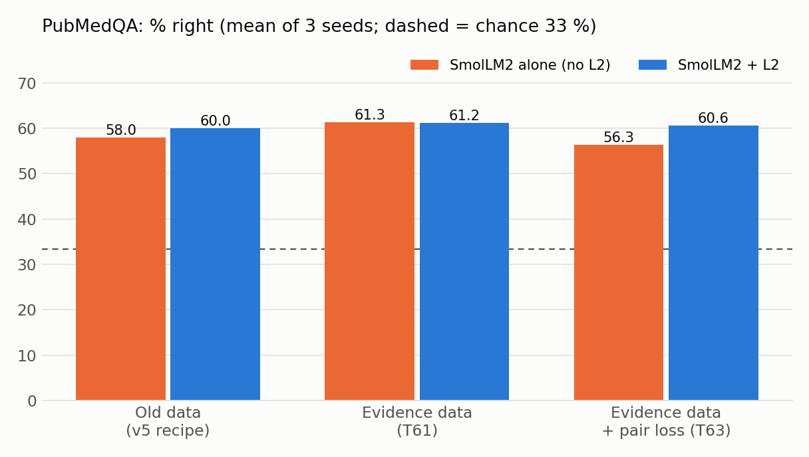
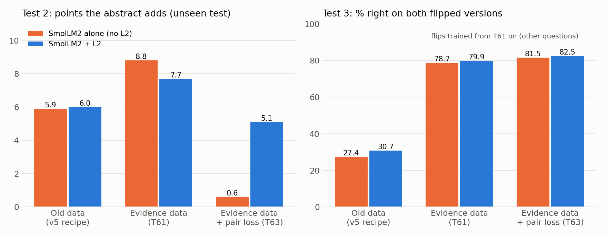
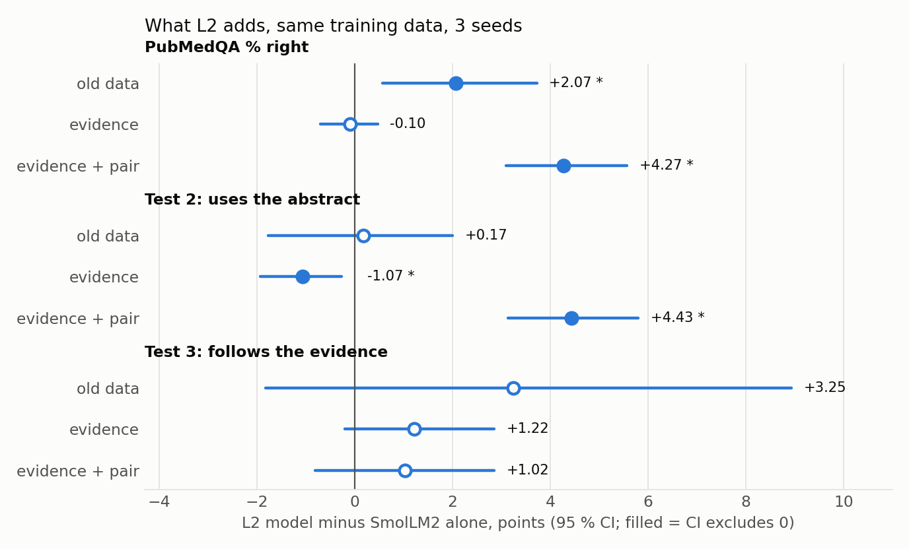
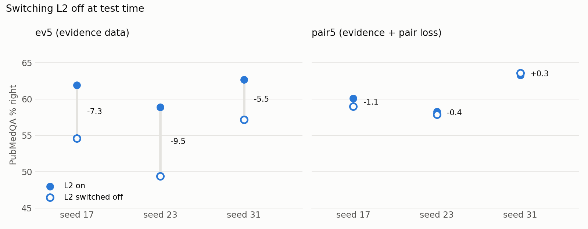
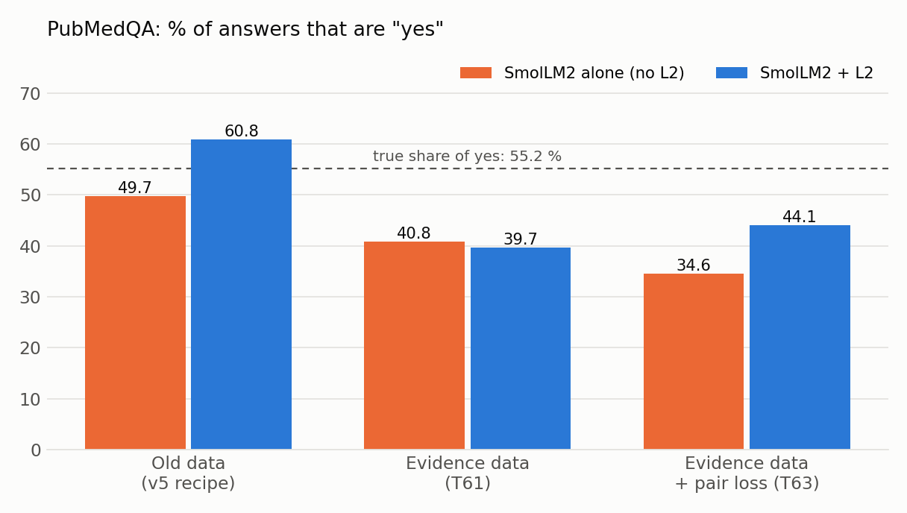

# Progress update: can the L2 add-on make a small model reason better?

*Ekdant — MSc thesis, Hochschule Heilbronn. Status 2026-11-11. Every number comes from the run reports in `run.md` (sections A7k–A7n); \* = the 95 % confidence interval excludes 0.*

## 1. In one paragraph

L2 is a small add-on (19.6 M parameters) on the pretrained language model SmolLM2-135M. It is meant to help the model reason. The final L2 model (v5) beats the same model without L2 on PubMedQA by **+2.07\* points** (three seeds). Three reasoning tests showed that this gain is an **answer preference** (L2 says "yes" more often), not better reasoning. We traced the cause to the training data: it is 92.8 % "yes", and the yes / no answer was never trained. Rebuilding the data so that the answer must come from the evidence (T61) helps **both** models a lot. For example, following a flipped piece of evidence rises from 27 % to 79–80 %, and PubMedQA reaches 61.3 % without L2. **L2 adds nothing on top.** A further loss over the flipped pairs (T63) made the baseline worse while the L2 model held up. But the L2 model's score does not change when L2 is switched off, so that difference is not L2 computing the answer. **So far no experiment shows that L2 makes the model reason better.** The data change is the part that worked.

## 2. Setup (unchanged throughout)

| Item | Value |
|---|---|
| Backbone | SmolLM2-135M (pretrained), full fine-tuning |
| L2 | gated add-on after the last layer, +19.59 M parameters, starts switched off (gate = 0) |
| Training | stage 1 PubMedQA (`pqa_artificial`), stage 2 MedQuAD (half), 3 epochs |
| Benchmarks | PubMedQA (1,000 labelled questions), MedMCQA, MedQA, MedQuAD perplexity, explanation writing |
| Comparison | every L2 model against **the same model without L2, trained on the same data**; seeds 17, 23, 31; paired bootstrap 95 % CI |
| Rule set before the runs | L2 "reasons better" only if reasoning tests 2 **and** 3 both show a starred gain |

**The three reasoning tests (T59):**
1. **Where the gain comes from.** This is accuracy split by the true answer, plus the share of "yes" answers. If the gain comes only from saying one answer more often, it is a preference.
2. **Uses the abstract.** This is the % right with the abstract minus the % right without it. More means the answer depends more on the evidence. This test is never trained on.
3. **Follows flipped evidence.** The authors' one-sentence conclusion is the only context, once as written and once with one negation flipped, so the right answer flips too. 164 questions; "right on both" counts as following the evidence.

## 3. How we got here

| Step | What we did | Result |
|---|---|---|
| v1 | 50 M model trained from scratch | only learned the most frequent answer letter → moved to a pretrained backbone |
| v2 – v2.2 | L2 on SmolLM2 at different places | at the end of the model works best (small perplexity gains) |
| v3 / v3b / v3c | L2 with confidence, voting, per-token gate | no better than v2.2 |
| v4 | L2 inside the model and at the end | worse than v2.2 (average −0.49\*) |
| **v5** (= v2.2 recipe) | final L2 model, three seeds | PubMedQA **+2.07\***, average of 3 benchmarks +0.72\*, MedQuAD ppl −0.16 %\* |
| T59 reasoning tests | is v5's gain reasoning? | **no:** "yes" answers +11.0\*, uses the abstract +0.17, follows the evidence +3.25 (both not starred) |
| T60 warm-up / LoRA | train L2 first, or LoRA | best perplexity, but PubMedQA −15\* (the model says "no" 85 % of the time); LoRA says "no" to every question |
| **T61 evidence data** | balanced yes / no + 45,774 flipped conclusion pairs | **both models improve a lot; L2 adds nothing** |
| **T63 pair loss** | loss over both rows of each flipped pair | hurts the baseline; L2 model holds, but not through L2 at test time |

**Why T61 (the data finding):** the PubMedQA training set has 211,269 rows, **196,144 of them "yes" (92.8 %)**. The training target was only the conclusion text, so the model never learned to write the yes / no word the benchmark scores. T61 rebuilds stage 1 as follows:
- **Balanced rows:** every "no" row plus as many "yes" rows (question + abstract → "yes. / no. + conclusion").
- **Flipped pairs:** each conclusion as written → its label, and flipped by one negation → the other label.

The 1,000 benchmark questions are excluded from training. T61 is cheaper to train (about a fifth of the text, 0.9 h per run).

**Why T63:** the literature (PairCFR, Qiu et al., ACL 2024) finds that flipped (counterfactual) pairs help more when a loss looks at both rows together. Our loss asks the yes-minus-no score to swap between the two versions. It costs no extra compute.

## 4. Results

### 4.1 PubMedQA accuracy

| Training data | SmolLM2 alone | SmolLM2 + L2 | L2 minus alone [95 % CI] |
|---|---|---|---|
| Old data (v5 recipe) | 58.0 | 60.0 | +2.07 [+0.57, +3.73]\* |
| Evidence data (T61) | 61.3 | 61.2 | −0.10 [−0.70, +0.47] |
| Evidence + pair loss (T63) | 56.3 | 60.6 | +4.27 [+3.10, +5.57]\* |

Over all three benchmarks (MedMCQA, MedQA, PubMedQA), the evidence data beats the old baseline:
- evbase (no L2): average **+1.25\***;
- ev5 (with L2): average **+1.22\***;
- for comparison, v5 on the old data: +0.72\*.

MedMCQA and MedQA do not change in any experiment (all within ±0.5 points, no star). They stay near chance (25 %) for a 135 M model.

### 4.2 Reasoning tests

| Model | Uses the abstract (test 2) | Follows flipped evidence (test 3) | Same answer on both versions |
|---|---|---|---|
| old baseline / v5 | 5.9 / 6.0 | 27.4 % / 30.7 % | 69.3 % / 65.7 % |
| evbase / ev5 | 8.8 / 7.7 | 78.7 % / 79.9 % | 13.8 % / 12.2 % |
| pairbase / pair5 | 0.6 / 5.1 | 81.5 % / 82.5 % | 14.0 % / 12.8 % |

- **Test 3 jumps from 27 % to about 80 %** with the evidence data. Caveat: from T61 on, the same kind of flip is in the training data (on other questions). So this shows the training worked; it is not an unseen test any more.
- **Test 2 (unseen):**
  - the evidence data raises it 5.9 → 8.8 (not starred);
  - the pair loss makes SmolLM2 alone almost **stop using the abstract** (0.6).

### 4.3 What L2 adds, with the same data

- **Old data:** the gain is a preference (yes +11.0\*). The tests show nothing.
- **Evidence data:** L2 adds nothing. It uses the abstract slightly *less* (−1.07\*).
- **Evidence + pair loss:**
  - this is the first starred gain on test 2, on every seed: **+4.43\*** (+4.8\* / +5.8\* / +2.7\*);
  - test 3 is not starred (+1.02), so the rule we set before the runs is **not met**;
  - and the next chart shows the gain is not L2's work at test time.

### 4.4 Switching L2 off at test time

**ev5 depends on L2:** without it, PubMedQA drops 5.5–9.5 points. Yet it is no better than the same model trained without L2. The backbone handed work to L2 rather than L2 adding something new.

**pair5 does not depend on L2:** its score is unchanged with L2 off (−1.1 / −0.4 / +0.3). Its gate stayed small (0.015 against 0.027). Two things follow:
- Even with L2 switched off, pair5 is about 4 points above pairbase. The difference sits in SmolLM2's own weights.
- Training next to L2 kept the backbone from collapsing under the pair loss. That is a training effect; it is not L2 reasoning at test time.

### 4.5 Answer preference

The true share of "yes" in the benchmark is 55.2 %.
- **v5** overshot to 60.8 % "yes".
- **Evidence data:** both models now under-say "yes" (about 40 %). They are right on 87–88 % of the true-no questions and 57–58 % of the true-yes ones.
- **Pair loss:** this pushes SmolLM2 alone further, to 34.6 % "yes".

### 4.6 Writing quality

Explanation perplexity:
- the evidence data improves it for both models: **−5.33 %\*** without L2, **−6.72 %\*** with L2;
- L2 itself: −1.46 %\* on the same data;
- generated MedQuAD answers (ROUGE-L): no consistent L2 difference.

The pair loss makes generated explanations worse: ROUGE-L −1.99\* (pairbase) and −3.15\* (pair5) against evbase.

## 5. What we conclude

1. **The data finding is the solid result.** The yes / no decision was never trained, and the data was 92.8 % "yes". Training the decision from balanced and flipped evidence improves PubMedQA (+3.3\* points) and the 3-benchmark average (+1.25\*). It also makes the model follow flipped evidence 80 % of the time instead of 27 %. And it is cheaper to train.
2. **L2 has not shown better reasoning in any experiment.**
   - Its earlier gain was an answer preference.
   - With the right data it adds nothing.
   - Where it did seem to help (pair loss), the effect is in how the backbone trained, not in what L2 computes. The test we set before the runs was not passed.
3. **The evaluation method is a result in itself.** Splitting accuracy by the true answer, measuring "uses the abstract", and the flipped-evidence test together turned an apparent +2 point "reasoning" gain into an answer preference. Accuracy alone would have hidden this.

## 6. Questions for the meeting

- **Thesis framing:** should the thesis report L2 as a careful negative result? That would mean an add-on that changes accuracy without reasoning better, shown with the three tests, plus the data finding as the positive contribution.
- **Next experiment, or stop:** is there one more L2 experiment worth running? One example is evaluating on an unseen flipped-evidence format, now that test 3 is trained-like. Or should the experiments stop here and the writing start?
- **Final model:** for the final model, take the evidence-data recipe, with or without L2? They score the same; ev5 has 19.6 M more parameters.

*Sources: `run.md` A7k (v5), A7l (reasoning tests, warm-up, LoRA), A7m (evidence data), A7n (pair loss); reports `gain_*.md` and `reason_*.md` in `09-Code`; design notes in `07-Management/30_Design_v2_Pretrained_Backbone.md`; open issues T59–T63 in `07-Management/10_Known_Issues.md`.*
