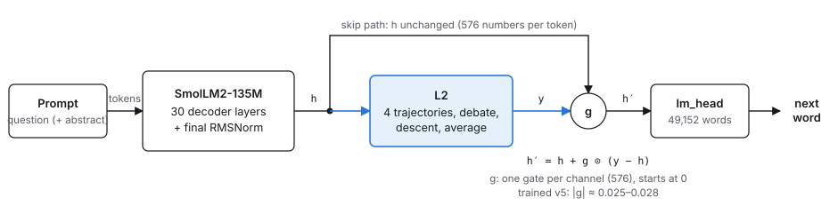
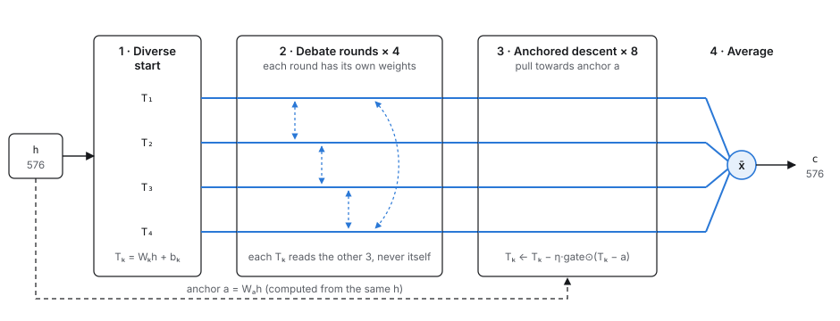
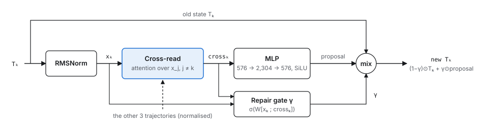

# Progress report: can the L2 add-on make a small model reason better?

*Ekdant — MSc thesis, Hochschule Heilbronn. Status 2026-11-11. Every number comes from the run reports in `run.md` (sections A2, A3o–A3s, A7k–A7n) and the code in `09-Code`; \* = the 95 % confidence interval excludes 0. Web version with the same content: the private artifact page (share it from its Share menu).*

## Summary

I built **L2**, a 19.6 M-parameter add-on, and attached it to the pretrained language model **SmolLM2-135M**. L2 runs four internal "trajectories" of the model's state, lets them debate, and averages them. The aim was better reasoning on medical question answering. After nine L2 versions (v1–v5), three seeds per final model and three reasoning tests, **L2 has not shown better reasoning anywhere.** Its best gain turned out to be an answer preference. The positive results came from the data (training the yes / no decision from the evidence, +3.3\* points on PubMedQA without any add-on) and from the evaluation method.

| Finding | Status |
|---|---|
| Training the decision from the evidence (T61) | **Worked:** PubMedQA 58.0 → 61.3 %\*, following flipped evidence 27 % → 79–80 %, 3-benchmark average +1.25\* |
| Three reasoning tests | **Worked:** they exposed L2's +2-point gain as a "yes" preference (+11.0\*) |
| The L2 layer | **Not useful:** reasoning never shown; +0.0 points with the right data; perplexity −<2 % but no better generated text |

## 1. The question

Small language models answer medical questions mostly by pattern-matching. The thesis idea: add a separate "thinking" module on top of a normal language model. Inside it, several candidate versions of the model's internal state (**trajectories**) start from different angles, read each other, revise, and agree on one answer state. This works like a small internal debate, all inside one forward pass, with no extra text generated.

The original design had two parts, L1 and L2. L1 is left for future work; this thesis tests **L2 alone**, on a pretrained model, against the same model without it.

> **Research question:** does SmolLM2 + L2 reason better on medical QA than SmolLM2 alone, trained on the same data? "Reason better" means more than higher accuracy (section 6).

## 2. The model

### 2.1 The backbone: SmolLM2-135M

A public pretrained decoder-only language model (Hugging Face) whose job is to predict the next word. All of its weights are fine-tuned (full fine-tuning); LoRA was tried only as one variant (T60).

| Property | Value |
|---|---|
| Parameters | 134,515,584 (≈ 135 M) |
| Layers | 30 decoder layers (self-attention + MLP each), RMSNorm, rotary position encoding |
| Hidden size | 576 numbers per token (the "state" h) |
| Attention | 9 query heads, 3 key/value heads (grouped-query attention) |
| Vocabulary | 49,152 tokens; the output layer (lm_head) shares weights with the input embedding |
| Context used | up to 1,024 tokens per example (answers up to 512) |

### 2.2 Where L2 attaches

In the final model (v5), L2 sits between SmolLM2's last layer and its output layer. For every token, SmolLM2 produces its final state `h` (576 numbers). L2 computes a refined state `y = RMSNorm(c)`. A learned gate decides how much of `y` replaces `h` before the output layer turns it into next-word probabilities:



```
h′ = h + g ⊙ (y − h)        g = 576 gates (one per channel), start at 0
```

At the start of training every gate is 0, so the model is exactly SmolLM2. In trained v5 the gates end at |g| ≈ 0.025–0.028: L2 changes roughly 3 % of the final state.

## 3. The L2 layer in detail

L2 works on **one token at a time**. It takes that token's final state `h` and runs four steps: **diverse start → 4 debate rounds → 8 anchored descent steps → average**. Settings are those of v5 (`configs/v5_final.json`; code `09-Code/src/ekdant/sandbox.py`, `model.py`).



*Blue lines: the four trajectories. Dashed blue arrows: the cross-reads in every debate round. Dashed black line: the anchor, computed from the same input h.*



*One debate round, for trajectory k. The repair gate γ lets a trajectory keep its own state rather than follow the others; its bias starts at −2, so at first γ ≈ 0.12.*

### 3.1 Step by step

```
input    h            final state of one token from SmolLM2 (576 numbers)

1 start  Tₖ = Wₖ·h + bₖ          k = 1..4
         W₁..W₄ start mutually orthogonal, gains spread 0.8 → 1.25,
         so the four trajectories begin as four different "views" of h

2 debate (4 rounds, each with its own weights)
         xₖ     = RMSNorm(Tₖ)
         crossₖ = Σ_{j≠k} softmax_j( (Q xₖ)·(K x_j) / √576 ) · V x_j
         γₖ     = sigmoid( W_γ [xₖ ; crossₖ] + b_γ )        b_γ starts at −2
         Tₖ    ← (1 − γₖ) ⊙ Tₖ + γₖ ⊙ MLP(crossₖ)          MLP 576 → 2,304 → 576, SiLU

3 descent (8 steps, η = 0.0625)
         a      = Wₐ·h                                       the anchor
         Tₖ    ← Tₖ − η · sigmoid(W_g [Tₖ ; a]) ⊙ (Tₖ − a)

4 average c  = (T₁ + T₂ + T₃ + T₄) / 4

output   y  = RMSNorm(c)
         h′ = h + g ⊙ (y − h)      g = tanh(gate), 576 gates, start at 0
         next-word logits = lm_head(h′)
```

### 3.2 Why each part is there

- **Diverse start:** if all four trajectories started equal, the debate would have nothing to argue about; orthogonal projections make them start apart.
- **Debate:** each trajectory attends to the other three (never itself) and proposes an update. The **repair gate** lets it decline the crowd, so a correct minority can survive a round.
- **Anchored descent:** pulls every trajectory back towards an anchor computed from the original state, so the debate cannot drift away from what the model read. A second gate decides per channel how strongly to pull.
- **Average:** the consensus is the plain mean of the four (`readout = mean`).
- **Spread floor (extra loss):** if the trajectories became identical, L2 would be just one MLP. The loss adds `λ·max(0, ρ_min − ρ)²`, with ρ = trajectory variance / size of h, ρ_min = 0.05, λ = 1.
- **Zero gate at start:** with g = 0, L2 starts as a no-op; both arms begin with exactly SmolLM2's output, so any difference is learned.

### 3.3 Parameter count (v5)

| Part | Weights | Parameters |
|---|---|---|
| Diverse start | 4 matrices 576×576 + 4 biases | 1,329,408 |
| One debate round | pre-norm 576 · cross-read Q, K, V 3×576² · repair gate 1,152→576 · MLP 576→2,304→576 | 4,317,120 |
| 4 debate rounds | 4 × the above | 17,268,480 |
| Anchored descent | anchor 576² · descent gate 1,152→576 | 995,904 |
| Output | output RMSNorm 576 · gate 576 | 1,152 |
| **L2 total** | | **19,594,944 (+14.6 %)** |
| SmolLM2 + L2 | | 154,110,528 |

### 3.4 What L2 can and cannot see

In v5, L2 works **per token**. It sees only that token's final state h, not the other tokens or the abstract itself. Everything it knows about the question and the abstract is what SmolLM2 has already put into h. Because it sits at the very end, no later layer reads its output either. So L2 can only *reshape* what SmolLM2 has computed; it cannot gather new evidence. Later versions (v3–v4) gave L2 its own attention over the text, a verifier, a vote and placements inside the network. None did better than v5.

## 4. Data: the old data, the evidence data (T61), the pair loss (T63)

### 4.1 Training data (all public)

| Dataset | What it is | Use |
|---|---|---|
| PubMedQA `pqa_artificial` | 211,269 research questions, each with a PubMed abstract, the authors' conclusion and an automatically generated yes / no label | Training, stage 1 (2,000 rows held out) |
| MedQuAD | 16,407 consumer health questions with answers from NIH websites (14,345 unique questions) | Split by unique question: one half trains stage 2 (10 % of it picks the checkpoint), the other half is only a benchmark |
| PubMedQA `pqa_labeled` | 1,000 questions with expert yes / no / maybe labels | Benchmark only; no PubMed id shared with the training set (checked) |

### 4.2 The "old data" (v1 – v5, T59, T60)

Stage 1 was trained as **question + abstract → write the authors' conclusion** (209,269 rows, about 85 M tokens per epoch). Two problems were found:
- **The labels are 92.8 % "yes":** 196,144 yes, 15,125 no, no maybe.
- **The yes / no word was never a training target.** The model only learned to write the conclusion, while the PubMedQA benchmark scores exactly that yes / no word. So the benchmark answer was a side effect of conclusion writing.

This is why L2 could improve PubMedQA by learning to say "yes" more often (the majority answer) without reading the evidence any better.

### 4.3 The evidence data (T61, `--evidence`)

This rebuilds stage 1 only; MedQuAD and every benchmark stay the same.

| Rows | Prompt | Target | Count (seed 17) |
|---|---|---|---|
| Balanced | question + abstract | `yes. <conclusion>` or `no. <conclusion>` | 29,934 |
| Flipped pairs | question + the conclusion only | `yes` / `no` | 2 × 45,774 |

- **Balanced:** every "no" row plus the same number of "yes" rows, so always saying "yes" scores only 50 %.
- **Flipped pairs:** each conclusion appears twice. Once as written, labelled with its real answer. Once with one negation added or removed (e.g. "does not improve" ↔ "does improve"), labelled with the opposite answer. Only a model that reads the sentence gets both right.
- Total: 121,482 short rows, about a fifth of the old text; a training run takes about 0.9 h. The 1,000 benchmark questions are excluded.

### 4.4 The pair loss (T63, `--pair-loss 1.0`)

With plain cross-entropy each row of a pair is trained on its own. PairCFR (Qiu et al., ACL 2024) reports that counterfactual pairs help more when the loss compares both rows. So both rows of a pair go into the same batch, and the loss adds:

```
m         = logit(" yes") − logit(" no")      at the first answer token
loss_pair = W · softplus( m(row labelled no) − m(row labelled yes) ),   W = 1
          ≈ 0       when the answer flips with the evidence
          = log 2   (0.69) when both versions get the same answer
```

It reuses the logits already computed (no extra compute). Both arms get it.

## 5. Training

| Item | Setting |
|---|---|
| Stage 1 | PubMedQA (old or evidence data), 1 epoch |
| Stage 2 | MedQuAD training half: question → answer, 3 epochs; better of best / last checkpoint on its 10 % slice |
| Batch | 8 sequences × 4 accumulation steps = 32 per update; bf16 on one A100 80 GB per run |
| Learning rates | SmolLM2 5e-5 · L2 matrices 1e-4 · gates 1e-3; AdamW, cosine per stage, 200 warm-up steps |
| Clipping | gradient norm 1.0, separately for SmolLM2 and L2 |
| Loss | next-token cross-entropy on answer tokens + spread floor (L2) + pair loss (T63 only) |
| Fair comparison | same data, order, split and starting weights for both arms; seeds 17, 23, 31 |

## 6. How we test

### 6.1 Multiple-choice accuracy

| Benchmark | What it is | Questions | Chance |
|---|---|---|---|
| PubMedQA (`pqa_labeled`) | research question + abstract → yes / no / maybe; expert labels | 1,000 | 33 % |
| MedMCQA (validation) | Indian medical entrance exams, 4 options | 4,183 | 25 % |
| MedQA-USMLE (test) | US medical licensing exam, 4 options | 1,273 | 25 % |

Scoring as in lm-evaluation-harness: the question is asked in the training format (`Question: … Answer:`, plus `Context:` for PubMedQA). The answer is the option with the highest mean log-probability per token; nothing is generated.

### 6.2 Text measures

- **Perplexity** of a reference text (lower = predicted better): MedQuAD benchmark half, MedMCQA expert explanations, PubMedQA conclusions.
- **Generated text:** the model writes its own MedMCQA explanation / PubMedQA conclusion (greedy, 200 per set), scored by ROUGE-L and by the % of explanations that **name the right answer**.

### 6.3 The three reasoning tests (T59)

| Test | What it measures | Reasoning would show as |
|---|---|---|
| 1 · Where the gain comes from | PubMedQA accuracy split by true answer, plus how often each answer is chosen | gains on yes *and* no questions, not just "says yes more often" |
| 2 · Uses the abstract | % right with the abstract minus % right without it; never trained on | a starred gain |
| 3 · Follows flipped evidence | the authors' conclusion as the only context, as written and with one negation flipped (164 questions); "right on both" counts | a starred gain in "right on both" |

> **Decision rule, fixed before the runs:** L2 "reasons better" only if tests 2 **and** 3 both show a starred gain over the same model without L2. From T61 on, flipped conclusions are in the training data (other questions), so test 3 is no longer unseen; test 2 stays unseen.

### 6.4 Statistics and the L2-off test

Every number is a mean over three seeds. Differences come with a **paired bootstrap 95 % CI**: questions are resampled, the same resample is used in every seed, and both models are scored on the same questions. Accuracy differences are **percentage points**. Every L2 model is also scored **with L2 switched off**: if the score stays, L2 is not doing the work at test time.

## 7. Versions and names

### 7.1 How we got here

| Step | What we did | Result |
|---|---|---|
| v1 | 50 M-parameter model with L2, trained from scratch | learned only the most frequent answer letter → pretrained backbone |
| v2.0 – v2.2 | L2 on SmolLM2: at the end (v2.0), after layer 20 (v2.1), at several depths (v2.2) | at the end works best; small perplexity gains |
| v3, v3b, v3c | L2 reads the text itself, starts at the model's state, verifier, vote, confidence, per-token gate; v3c "thinks twice" | no better than v2.2 |
| v4 | L2 inside the network and at the end, reading earlier layers | worse than v2.2 (average −0.49\*) |
| **v5** | final L2 model = the v2.2 "end" recipe (section 3), three seeds | PubMedQA **+2.07\***, average +0.72\*, MedQuAD ppl −0.16 %\* |
| v5drop, v5out | L2 off on 30 % of training steps (T57); L2 output at the model's scale (T58) | neither better than v5 |
| T59 | three reasoning tests on v5 | a preference: "yes" +11.0\*; tests 2 and 3 not starred |
| T60 | L2 warm-up first, or LoRA | best perplexity, but PubMedQA −15\* (85 % "no"); LoRA answers "no" to everything |
| T61 | evidence data (4.3) | both arms improve a lot; L2 adds nothing |
| T63 | pair loss (4.4) | hurts the baseline; L2 model holds, but not through L2 at test time |

### 7.2 Glossary

| Name | Meaning |
|---|---|
| T-numbers | entries in the issue list `07-Management/10_Known_Issues.md`; each is one problem or experiment |
| v-numbers | versions of the L2 design (v1 … v5) |
| baseline | SmolLM2 alone (no L2), old data |
| v5 | SmolLM2 + L2, old data; the final L2 model |
| evbase / ev5 | SmolLM2 alone / + L2, evidence data (T61) |
| pairbase / pair5 | the same two, evidence data + pair loss (T63) |
| gate g | 576 numbers deciding how much of L2's output reaches the output layer; 0 = L2 off |
| trajectory | one of L2's four candidate versions of the token's state |

## 8. Results

### 8.1 PubMedQA accuracy


| Training data | SmolLM2 alone | SmolLM2 + L2 | L2 minus alone [95 % CI] |
|---|---|---|---|
| Old data (baseline / v5) | 58.0 | 60.0 | +2.07 [+0.57, +3.73]\* |
| Evidence data (evbase / ev5) | 61.3 | 61.2 | −0.10 [−0.70, +0.47] |
| Evidence + pair loss (pairbase / pair5) | 56.3 | 60.6 | +4.27 [+3.10, +5.57]\* |

- Against the old baseline, the evidence data gives **+3.30\*** without L2 and +3.20\* with L2; the 3-benchmark average is +1.25\* / +1.22\* (v5: +0.72\*).
- MedMCQA and MedQA never change by more than ±0.5 points (no star); they stay near chance for a 135 M model.

### 8.2 Reasoning tests


| Model | Uses the abstract (test 2) | Follows flipped evidence (test 3) | Same answer on both versions |
|---|---|---|---|
| baseline / v5 | 5.9 / 6.0 | 27.4 % / 30.7 % | 69.3 % / 65.7 % |
| evbase / ev5 | 8.8 / 7.7 | 78.7 % / 79.9 % | 13.8 % / 12.2 % |
| pairbase / pair5 | 0.6 / 5.1 | 81.5 % / 82.5 % | 14.0 % / 12.8 % |

Test 3 jumps from about 27 % to 80 % with the evidence data. This shows the training worked; it is no longer unseen. The pair loss makes SmolLM2 alone almost stop using the abstract (0.6).

### 8.3 What L2 adds on the same data


- **Old data:** the gain is a preference (+11.0\* more "yes"); tests 2 and 3 not starred.
- **Evidence data:** L2 adds nothing and uses the abstract slightly *less* (−1.07\*).
- **Pair loss:** first starred test-2 gain, every seed (+4.8\* / +5.8\* / +2.7\*). But it is measured against a damaged baseline, test 3 is not starred (+1.02), and the L2-off test shows it is not L2's work.

### 8.4 Switching L2 off at test time


- **ev5 depends on L2** (PubMedQA −5.5 to −9.5 points with it off), yet it is no better than the model trained without L2: SmolLM2 handed part of its work to L2.
- **pair5 does not** (−1.1 / −0.4 / +0.3; gate 0.015 against 0.027). Its lead over pairbase sits in SmolLM2's own weights: L2 changed how the backbone trained, not what is computed at test time.

### 8.5 Answer preference


The true share of "yes" is 55.2 %. v5 overshot (60.8 %). The evidence-trained models under-say "yes" (≈ 40 %): right on 87–88 % of true-no and 57–58 % of true-yes questions. The pair loss pushes SmolLM2 alone to 34.6 %.

### 8.6 Text generation

| L2 minus alone, same data | Old data (v5) | Evidence data (ev5) |
|---|---|---|
| MedQuAD perplexity | −0.16 %\* | −0.15 %\* |
| MedMCQA explanation perplexity | −1.78 %\* | −1.46 %\* |
| PubMedQA conclusion perplexity | −0.45 %\* | +0.84 %\* (worse) |
| Generated: explanation ROUGE-L | +0.05 | +0.01 |
| Generated: explanation names the right answer | −0.67 | −0.83 |
| Generated: conclusion ROUGE-L | −0.35 | −0.02 |

- **L2 lowers perplexity a little** (under 2 %, every seed), but the text it writes is no better: no generated-text measure differs significantly.
- The evidence data has the larger effect: explanation perplexity −5.33 %\* (no L2) and −6.72 %\* (with L2) against the old baseline, at the cost of PubMedQA conclusion perplexity (+11.7 / +12.7 %\* worse, less conclusion text trained).
- The pair loss makes generated explanations worse: ROUGE-L −1.99\* (pairbase) and −3.15\* (pair5) against evbase.

## 9. Verdict and conclusions

**L2 is not useful for this task and is not worth keeping.** What the project produced comes from the work around it.
- **Reasoning:** never shown; the pre-registered test was never passed.
- **Accuracy:** its only fair gain (+2.07\* PubMedQA, old data) was a "yes" preference; with the evidence data it adds −0.10 points; MedMCQA and MedQA never moved.
- **Text generation:** perplexity drops by under 2 %, but the written text is no better.
- **Cost:** 19.6 M extra parameters (+14.6 %); the model learns to lean on L2 (ev5 loses 5.5–9.5 points with it off) without beating the model trained without it.
- **A likely reason (interpretation):** in v5, L2 only reshapes each token's final state (3.4); it has no access to evidence SmolLM2 has not already encoded. The versions that let L2 read the text (v3–v4) were not better either.

**What the thesis can claim:**
1. **The data finding.** The yes / no decision was never trained and the data was 92.8 % "yes". Training the decision from balanced and flipped evidence improves PubMedQA (+3.3\*) and the 3-benchmark average (+1.25\*), raises following flipped evidence from 27 % to 80 %, and is cheaper to train.
2. **The evaluation method.** Splitting accuracy by the true answer, "uses the abstract", the flipped-evidence test and the L2-off test turned an apparent +2-point "reasoning" gain into an answer preference. Accuracy alone would have hidden it.
3. **A careful negative result for L2**, against a same-data baseline on three seeds with confidence intervals.

## 10. For discussion

- Frame the thesis as a careful negative result for L2, with the data finding and the test method as the positive contributions?
- Stop experiments and start writing, or one more check (e.g. an unseen flipped-evidence format, since test 3 is now trained-like)?
- **Final model:** proposed the evidence-data recipe **without** L2 (evbase): same score as ev5, 19.6 M fewer parameters.

*Sources: `run.md` A2, A3o–A3s, A7k–A7n; reports `gain_*.md`, `reason_*.md` in `09-Code`; code `09-Code/src/ekdant/sandbox.py`, `model.py`, `configs/v5_final.json`; design notes `07-Management/30_Design_v2_Pretrained_Backbone.md`; issues T59–T63 in `07-Management/10_Known_Issues.md`. Diagrams: `figures/l2_1..3_*.svg`.*
