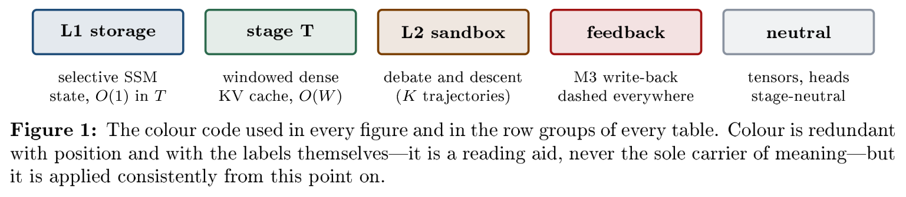
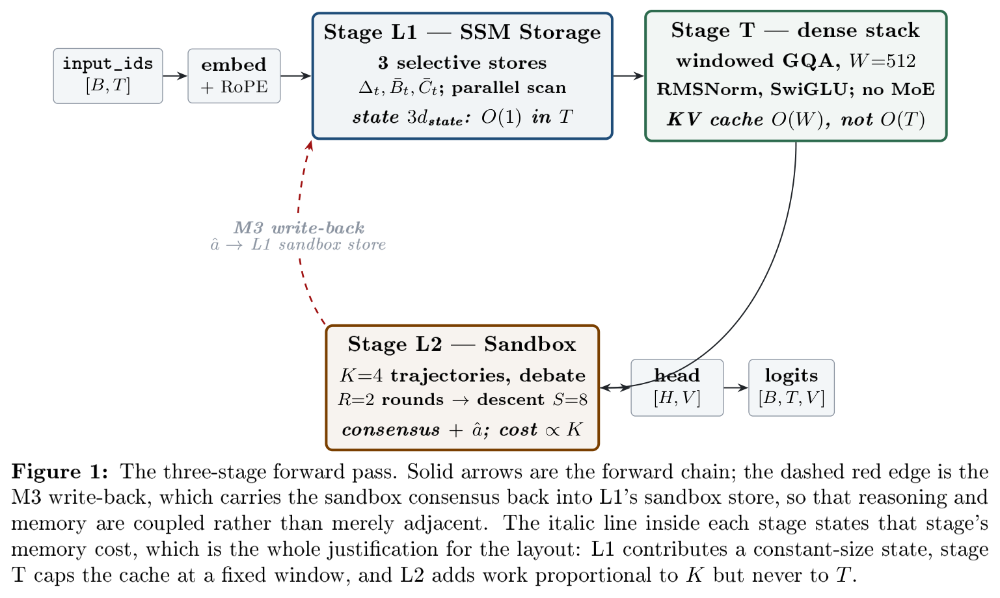
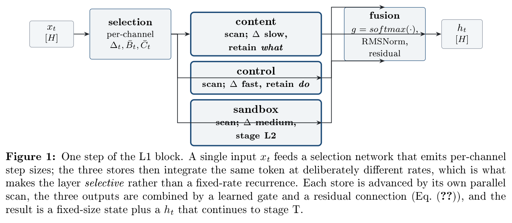
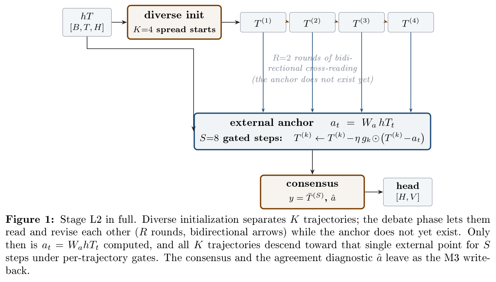
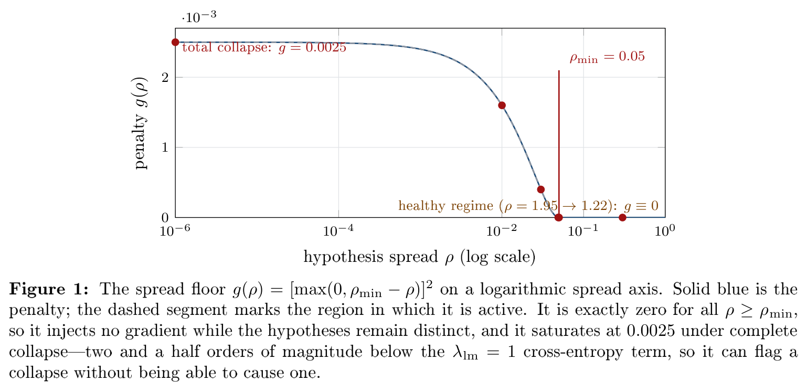
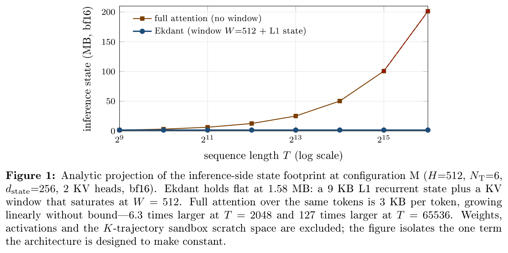
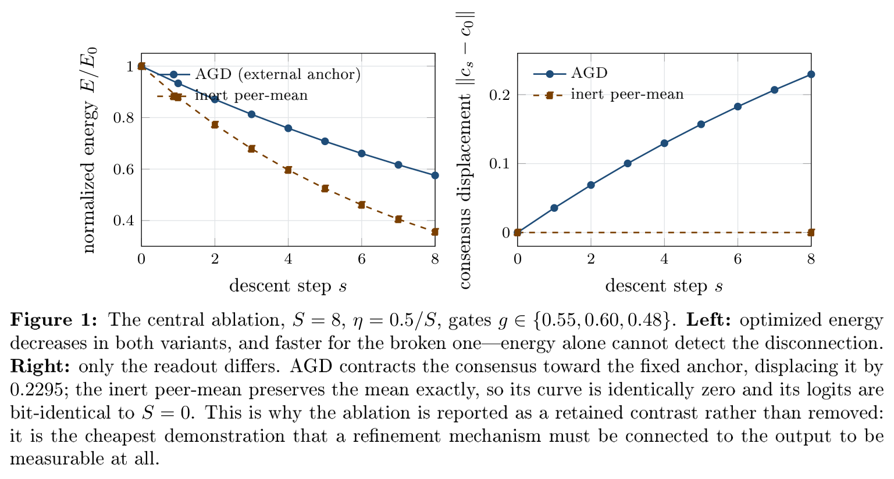

# Ekdant: A Parallel Sandbox with Anchored Gated Descent for Medical Multiple-Choice Reasoning

**Harshil Gorasiya** — MSc Thesis, Hochschule Heilbronn
Supervisor: [Supervisor 1] · Co-supervisor: [Supervisor 2]

> Compiled from this vault. Canonical spec: [02_System_Architecture.md](../02-Architecture/02_System_Architecture.md). Sources: [01](../01-Introduction/01_Project_Overview.md) · [19](../03-Background/19_Thesis_Ch2_SSM_Storage_Papers.md) · [20](../03-Background/20_Thesis_Ch2_Sandbox_Papers.md) · [21](../04-Model-DeepDive/21_Thesis_Ch3_Layer1_SSM_Storage.md) · [22](../04-Model-DeepDive/22_Thesis_Ch3_Layer2_Sandbox.md) · [05-Data](../README.md) · [07](../06-Training-Eval/07_Training_Pipeline.md) · [12](../02-Architecture/12_Configuration_Guide.md) · [09/14](../README.md) · [11](../07-Management/11_Future_Work.md).

> [!important] **Scope of the built system.** The evaluated configuration (v2) puts L2 on a
> pretrained **SmolLM2-135M** as a zero-init gated residual and compares two arms — backbone
> alone (134.52M) and + L2 (+19.59M, architecture-matched) — on generative medical QA
> (PubMedQA → MedQuAD, split by question), by reference-answer perplexity with a paired bootstrap.
> The from-scratch pilot (`embed → T → L2 → head`, ~50M, MedMCQA → MedQA) is reported as the
> motivation: it learned only the answer-letter prior (T27, T28). The L1 selective-SSM storage
> layer and the M3 write-back are **specified in this thesis but not implemented**; every L1
> statement below is design, not result.

> [!note] This file is the **condensed vault-linked outline**. The full article, with the
> notation tables, proofs, prior-art audit and all 70 references, is [thesis.pdf](thesis.pdf),
> built from [thesis.tex](thesis.tex). Where the two differ, the PDF is authoritative.

---

## Figures

The seven diagrams from the compiled article, exported at 240 dpi.

**Fig. 1 — Colour key.** Fixed code used by every figure and every table row group.

| Colour | Meaning | Applied to |
|---|---|---|
| Blue `#1F4E79` | Stage L1 — storage / memory | L1 boxes, parameter-table rows |
| Green `#2E6B4F` | Stage T — local dense compute | T boxes, parameter-table rows |
| Orange `#7B3F00` | Stage L2 — reasoning | L2 boxes, sandbox-store row |
| Red `#A11212` | Feedback / defect | M3 arrows, `[PENDING]` rows |
| Grey `#8A94A0` | Stage-neutral tensors, heads | Embedding, head, projections |

**Fig. 2 — Three-stage forward pass.** Solid arrows are the forward chain; the dashed red edge is the
M3 write-back that returns **L2's** consensus into L1's third state store (`S^sandbox`). L1 and L2 are
separate stages; the store is SSM memory, the sandbox is the debate layer.
*L1 and the write-back are design only; the built model is embed -> T -> L2 -> head.*

**Fig. 3 — One L1 step.** Selection emits per-channel step sizes; three stores integrate the same
token at different rates; a learned gate fuses them with a residual.

**Fig. 4 — Stage L2 in full.** Debate is horizontal (trajectories interact, anchor not yet defined);
anchored descent is vertical (all trajectories move toward one external point).

**Fig. 5 — The spread floor.** Exactly zero across the healthy regime; bounded at 0.0025 under total
collapse, so it can flag collapse without causing it.

**Fig. 6 — Inference state vs. sequence length.** Ekdant holds flat at 1.58 MB; full attention grows
linearly, reaching 127x at T = 65536. *Analytic projection for the full design with L1, not measured and not the built model.*

**Fig. 7 — The central ablation.** Energy falls in *both* variants, and faster for the broken one — so
energy cannot detect the disconnection. Only the readout differs: AGD moves the consensus, the inert
peer-mean leaves it bit-identical to S = 0.

---

---

## Ch.1 — Introduction

**Problem.** Transformer decoders scale quadratically in sequence length (KV-cache growth); a monolithic stack hides which part reasons; softmax confidence is uncalibrated. Long inputs — codebases, records, papers with references — are exactly where reasoning matters and where attention costs most.

**Idea: Ekdant.** Two layers — ==L1 SSM Storage== (selective state-space memory; *specified, not built*) and ==L2 Sandbox== (K trajectories + debate/energy consensus; *built*) — joined by a ==dense Transformer stack T== (windowed GQA + SwiGLU, no MoE; *built*). The evaluated model is the A/B pair ==50.09M (T + L2) vs 43.53M (T alone)== on medical multiple-choice QA. Losses: ==LM CE + answer-letter CE (`--answer-weight`) + sandbox spread floor==.
- ==Layer 1 — SSM Storage (memory answer; design only).== Selective state-space stack compresses any sequence into a fixed-size recurrent state. Linear-time training, ==O(1) inference==, no KV-cache. ([21](../04-Model-DeepDive/21_Thesis_Ch3_Layer1_SSM_Storage.md))
- ==Layer 2 - Sandbox (reasoning answer; built).== The T output expands into ==K parallel trajectories== that debate (cross-read + revise), then run ==anchored gated descent== on the energy `½‖T_k − a_t‖²` toward a token-conditioned anchor `a_t = W_a·hT_t`, and vote. Agreement is the observable confidence signal; collapse is policed by a spread *floor*, not an agreement penalty. ([22](../04-Model-DeepDive/22_Thesis_Ch3_Layer2_Sandbox.md))

Built forward: `input_ids → embed → T (windowed GQA + SwiGLU) → K trajectories → debate → anchored gated descent → consensus → tied head → logits`. Full-design forward adds `SSMStack` before T and the M3 write-back.
- ==Why dense + windowed:== global attention's growing KV-cache is the wall from Ch.1; T keeps a fixed window (W=512), so its cache stays bounded. No MoE — the sandbox is the mixture mechanism.
- ==Bounded-memory story (full design):== L1 fixed state + T window-bounded KV + dense FFN + K-bounded sandbox — peak memory flat in T. Untested until L1 exists.

**Research questions.**
- ==RQ1 (memory) — future work:== Can fixed-size selective SSM replace the KV-cache at matched quality? Needs L1; protocol pre-specified, not run here.
- ==RQ2 (reasoning):== Does the same backbone with the K-trajectory sandbox beat the identical backbone without it on MedMCQA/MedQA letter accuracy? Architecture-matched (+6.56M params, extra compute), so a depth-/parameter-matched control is the informative follow-up. Ablations: K=1/4/8; rounds 0/2/3; steps 0/8; anchor vs peer-mean. GSM8K/HumanEval are ==scaling-held-out== because the smallest model reported past 80% GSM8K is 34B (arXiv:2312.09241).
- ==RQ3 (honesty):== Does trajectory agreement predict correctness? Measure agreement-vs-accuracy calibration (batch-level diagnostics now persisted; needs a per-example export).

**Contributions.** (1) A minimal three-stage design (SSM memory → dense T → sandbox reasoning) with no MoE; T and L2 built and tested, L1 specified. (2) In-graph debate plus anchored energy descent with cost-matched evaluation, and an audit proving the discarded peer-mean variant inert. (3) ==66-paper local library== ([proof index](../papers/Proof_Library/00_Proof_Index.md), [novelty audit](../04-Model-DeepDive/29_Prior_Art_and_Novelty_Check.md)) mapping every design choice to a downloaded source. (4) A reproducible sequential MedMCQA → MedQA training/benchmark pipeline with a leakage-free protocol (seed-locked 60/40 MedQA split, untouched 40% benchmark, selection on MedMCQA validation).

**Scope.** Text-only, trained from scratch on MedMCQA and MedQA; letter-accuracy evaluation; honesty probes. No tools, multimodality, MoE, SFT/DPO, or general-purpose LM claims.

---

## Ch.2 — Background

### §B Why selective SSM (L1)
Lineage: S4 (Gu et al. 2021, B1) → diagonal S4D/DSS (B2/B3) → S5 parallel scan (B4) → ==selection + scan: Mamba (Gu & Dao 2023, B5, primary L1 blueprint)== → duality SSD/Mamba-2 (B6). Foundations: HiPPO (B13), LRA benchmark (B14). Family: Hyena (B7), H3 (B8), RetNet (B9), RWKV (B10), Griffin (B17), xLSTM (B19), MambaByte (B18), S4ND (B15), Liquid-S4 (B16). Baselines: FlashAttention (B20). Limitation anchor: ==Jamba hybrid (B11)== + surveys (B12a) — pure SSM trails attention on exact recall; thesis stays pure for falsifiability. Full vault: [19](../03-Background/19_Thesis_Ch2_SSM_Storage_Papers.md).

> L1 follows the selective-SSM line (S4; diagonal; S5; selection+scan; duality), with Hyena/H3/RetNet/RWKV as family context and Jamba + surveys marking the acknowledged retrieval limitation.

### §C Why parallel-trajectory sandbox (L2)
Control: ==CoT single path (Wei et al. 2022, C1) = K=1==. Baseline: ==self-consistency voting (Wang et al. 2022, C2)== — every sandbox claim is measured against it at matched budget. Blueprints: ==multi-agent debate (Du et al. 2023, C3)== for rounds; ==energy calibration for implicit CoT (2025, C11)== for descent, plus the energy-descent lineage (Energy Transformer C25, NRGPT C26) — Ekdant anchors descent to the backbone state, not to the peer mean, because the peer-mean pull is provably consensus-preserving. Support: ToT/GoT search structure (C4/C13), least-to-most decomposition (C17), folded reflection (C6/C7), process supervision (C12/C16), self-improve/STaR loops (C14/C15), divergent init (C19), debate dynamics (C9), debate-judge eval (C18), RASC early-stop (C20), latent-agent internalization as future (C10). ==Closest architectural priors== (all fetched locally): multi-stream hypotheses in one model (C21), heads reading each other (C22), function-separated streams at 29M (C23), latent iterative refinement (C29, TRM), energy descent (C25/C26), layered proposal-aggregation (C27), diversity-collapse evidence that forced the floor (C28) — **and C24, the compute-matched negative result** (Rauba et al. 2026, Tiny Autoregressive Recursive Models: the full Autoregressive TRM "shows no reliable gain / no consistent benefit") — see [29](../04-Model-DeepDive/29_Prior_Art_and_Novelty_Check.md). **Novelty claimed is the combination plus the M3 write-back, not any single ingredient.**

> **Cite C24 against your own interest.** It is the only paper in this library that runs a *compute-matched* comparison of exactly our design question, and it concludes that the full recursive TRM "shows no reliable gain (**no consistent benefit**)". Do not cite it as support. Cite it as the reason RQ2 is pre-registered with a **depth-matched-no-sandbox** control (same parameters, same block-pass budget, no L2) in addition to K=1, and as the reason a tie is a publishable outcome. What survives from it is narrower and still useful: *stream separation* helped (dual/two-stream), independently corroborated by C23 at 29M — so defend that part, and treat the recursive-refinement part as the hypothesis under test. Cost honesty (load-bearing): ==MAD critique (Smit et al. 2024, C8)== — report tokens×K and FLOPs always. Scope: acting with tools out (ReAct C5, cited to draw boundary). Full vault: [20](../03-Background/20_Thesis_Ch2_Sandbox_Papers.md).

> Single-path CoT is the K=1 control; self-consistency is the matched-budget baseline. Debate + energy descent are the tested improvements, evaluated under the cost-aware critique with overturn and calibration analysis.

### §D Why a dense Transformer backbone (T)

T follows the standard decoder block (Vaswani et al. 2017) in pre-norm form (Xiong et al. 2020; Zhang & Sennrich 2019), with rotary positions (Su et al. 2021, extended per Peng et al. 2023), grouped queries (Shazeer 2019; Ainslie et al. 2023), gated feed-forward (Shazeer 2020), a Mistral-style fixed window (Jiang et al. 2023) computed with stock math in the FlashAttention lineage (Dao 2023) — adapted to the 50M build (H=512, N_T=12), MoE deliberately omitted since the sandbox debates instead. Full vault: [25](../03-Background/25_Thesis_Ch2_Transformer_Papers.md).

---

## Ch.3 — Method (cite [02](../02-Architecture/02_System_Architecture.md))

**System.** Package `09-Code/src/ekdant/`: `model.py` (assembly + loss), `transformer_stack.py` (T), `sandbox.py` (L2), `output_head.py` (tied head), `data.py` (MedMCQA/MedQA pipeline + tokenizer), `train.py` (sequential training/eval). Pure PyTorch, 145 tests. Spec: [03_Codebase_Map](../02-Architecture/03_Codebase_Map.md).

**L1 — SSM Storage (design only, not built).** `input_ids [B,T]` → tied embed `[B,T,H]` + RoPE (base 100K, window 4096, YaRN-extendable) → N aSSM blocks (shared trunk + 3 L1 state stores: content/control/sandbox — the third *is an L1 store*, not the L2 layer; per-channel Δ/B/C, scan, gating+residual+norm) → `h [B,T,H]` + pooled triple `compressed [B,3·d_state]` handed to T; the L2 consensus write-back returns via M3. Design sizes — XS: H=256, d=96, N=2, V=32K · S: H=320, d=128, N=4, V=32K · M: H=512, d=256, N=4, V=32K; T=2048 all.

**Layer T — Dense Transformer (built).** embeddings → N_T=12 identical blocks (H=512, 8 heads / 2 KV heads, windowed GQA W=512 + SwiGLU 1024, RoPE, RMSNorm) → `hT`. KV bounded by W. 26.75M params. (Design sizes were N_T=3/5/6.)

**L2 - Sandbox (built, 6.56M params).** `hT` → ==K=4 diverse inits== `[K,B,T,H]` → R=2 debate rounds (cross-attention + revise) → ==S=8 anchored gated descent== (`a_t = W_a·hT_t`, per-trajectory gate `g_k`) → consensus `y` (mean default) → ==single dense `[H,V]` head== → logits. Monitors: `anchor_energy`, `trajectory_variance`, `spread_ratio ρ = trajectory_variance / mean(hT²)`. The only L2 training term is the floor `max(0, ρ_min − ρ)²` — zero unless the hypotheses collapse. A pull toward the *running mean* was tried first and **proved inert** (`logits(S=0) == logits(S=8)`); anchor + gate fixes it, and the inert variant is kept as a reported contrast ablation ([29](../04-Model-DeepDive/29_Prior_Art_and_Novelty_Check.md)).

**Losses.** `loss = lm_ce + answer_weight · ce(answer letter) + 1.0 · max(0, 0.05 − ρ)²` (the floor exists only in the sandbox arm; shipped λ_sbx = 1.0, design value was 0.1; `--answer-weight 10` in the campaign), dense causal CE, head run once per micro-batch. The L2 term is a dimensionless collapse floor, deliberately **not** an agreement/MSE penalty — such a penalty is minimized by the very collapse it would be meant to detect. The answer-letter term exists because the letter is 1 token in ~34 (MedMCQA) / ~173 (MedQA), so plain CE dilutes the scored decision ~97–99% (T22).

**Parameter split (measured).** Embeddings 16.78M · T 26.75M · L2 6.56M → sandbox 50.09M, baseline 43.53M. L2 is 2.3× the closed-form estimate (2.8M): full H×H q/k/v cross-projections and an H→2H→H MLP, untied across rounds.

---

## Ch.4 — Data

**Evaluated configuration (v2)** ([05_Data_Pipeline.md](../05-Data/05_Data_Pipeline.md) §v2):
- ==PubMedQA `pqa_artificial`== (211,269): question + abstract → conclusion; 2,000 seeded rows held out, 209,269 train phase 1 (~85M tokens per epoch).
- ==MedQuAD== (16,407 rows, 14,345 unique questions): split **by question** (seed 17) into a benchmark half (scored once) and a fine-tune half, 10 % of whose questions choose the checkpoint.
- Prompts `Question: … (Context: …) Answer:`; loss and perplexity on answer tokens only; answers ≤ 512 tokens, sequences ≤ 1,024 (abstract trimmed). SmolLM2 tokenizer (49,152).

**Pilot (from scratch):** two public datasets, used in strict sequence ([05_Data_Pipeline.md](../05-Data/05_Data_Pipeline.md)):
- ==MedMCQA== (`openlifescienceai/medmcqa`): 182,822 train rows → **182,496 labelled** (326 unlabelled dropped) for phase 1; 4,183-row labelled validation split (4,170 usable after the row filters) is never trained on (selection set + retention). The public test split ships `cop = -1` and is **never scored** (T18).
- ==MedQA== (`GBaker/MedQA-USMLE-4-options`): 10,178 train → seed-locked **60% fine-tune (6,106)** / **40% benchmark (4,072, untouched, scored once)**; official test (1,273) also untouched.
- Prompt: question, four lettered options, `Answer:`; target is the letter token. Evaluation = argmax over the four letter logits at the answer position.
- Lengths: MedMCQA p50/p99 = 34/118 tokens, MedQA p50/p99 = 173/364 (max 857); 0 of ~198k rows exceed 2048, so nothing is truncated.
- Tokenizer: BPE configured for 32,768 entries, trained once on 20,000 MedMCQA prompts (it learns 26,766, so 6,002 embedding rows — 3.07M parameters per arm — are never used), shared by both arms.

---

## Ch.5 — Training

**Evaluated configuration (v2)** ([run.md](../run.md) Part A): one recipe for both arms — AdamW, backbone LR 5e-5, add-on + gate LR 1e-4 (no decay on the gate), cosine per phase with 200 warm-up steps, clip 1.0, bf16, effective batch 32; 1 PubMedQA epoch (validation every 25 %), 3 MedQuAD epochs (validation each epoch → `best.pt`); better of best/last on the validation questions; one arm per A100; seed 17.

**Pilot recipe:** ([run.md](../run.md) §3), identical for both arms: phase 1 = all MedMCQA, 100 epochs, lr 3e-4 cosine, warmup 200; phase 2 = 60% MedQA, 10 epochs, lr 5e-5 (own cosine + warmup); **381,480 optimizer steps**; effective batch 48 (6 × 8 accum on one 16 GB T4); AdamW wd 0.1, betas (0.9, 0.95), clip 1.0, dropout 0.1, bf16/fp16 autocast, `--answer-weight 10`, seed 17 (also locks the 60/40 split). Anti-overfit knobs (`--ft-lr`, `--ft-epochs`) exist because a 40-epoch pilot memorised the small MedQA set (T21). Checkpoint = better of `best.pt` vs `last.pt` on untouched MedMCQA validation. Gate: 145-test suite + smoke run per arm. Knobs: [12](../02-Architecture/12_Configuration_Guide.md).

---

## Ch.6 — Evaluation & Results

**Protocol** ([09](../06-Training-Eval/09_Validation_System.md)): letter-accuracy on `medqa_bench` (decision gate, 4,072 rows, scored once), official `medqa_test` (1,273), MedMCQA validation phase-1 vs final (retention). The floor is the majority-letter rate, not 25 % (MedMCQA val 32.11 %, `medqa_bench` 25.69 %, `medqa_test` 27.73 %; T27).

**First baseline run (v2, one seed, ~1 h 15 min on one A100):** MedQuAD benchmark perplexity 7.578 → **3.782** (8,258 answers; validation 3.958); ROUGE-L 0.316 / token F1 0.380 on 1,000 generated answers; PubMedQA held-out 9.703 → 7.534 after phase 1 → 8.192 after the fine-tune (some forgetting). The first sandbox run diverged (T32); both arms are being re-run as a pair.

**Evaluated configuration (v2) — sandbox `[PENDING]`:** zero-shot / phase-1 / final reference-answer perplexity on the MedQuAD benchmark half (with per-question-type breakdown), paired-bootstrap 95 % CI of each arm vs the baseline (a difference counts only if the CI excludes 0), ROUGE-L / token F1 on 1,000 generated answers, PubMedQA held-out retention, `|g|`, cost. A CPU smoke run with the real backbone completed (pipeline check, not a result).

**Completed (pipeline-scale pilot, not a thesis result):** full 3-epoch A/B on a T4, one seed, jointly trained (predates the sequential protocol; MedQA stage ≈ 638 steps so it sits at chance).

| Arm | Params | MedMCQA val (4,170) | MedQA test (1,273) |
|---|---|---|---|
| Baseline (no L2) | 43.53M | 33.31% | 25.69% |
| Sandbox (L2) | 50.09M | 32.01% | 26.08% |

MedMCQA gap 1.3 pts vs noise σ ≈ 0.7 → **a tie** at this scale (pre-committed to report it).

**Legacy 100-epoch baseline (no `--ft-*` knobs):** MedMCQA val after phase 1 33.33 % (train CE 0.58 vs val CE 4.61 — memorisation; no gain over 3 epochs), `medqa_bench` 26.89 %, `medqa_test` 27.02 %. Evidence for T21/T25: pick phase-1 epochs from the validation curve.

**Pending (`[PENDING]`):** 100-epoch campaign (both arms; `medqa_bench`, `medqa_test`, MedMCQA phase-1 → final); cost report (params, tokens×K, FLOPs, wall-clock); depth-/parameter-matched control; K/R/S ablations; ρ_min sweep and anchor-vs-peer-mean; agreement-vs-accuracy calibration (needs a per-example agreement export); multi-seed variance; L1 layer-ladder step.

---

## Ch.7 — Future Work (from [11](../07-Management/11_Future_Work.md))

Critical (defense): pick phase-1 epochs from the validation curve → run the campaign for both arms → depth-/parameter-matched control and K/R/S ablations (report ties honestly) → multi-seed. High: implement L1 (`ssm_storage.py`) and the O(1) proof + M3 write-back; resolve the L2 size overage. Medium: scale-up to a 500M-class model on a larger GPU. Boundary: tools, multimodality, MoE, internalized debate each need their own RQ.

---

## Limitations
No L1 (memory claim and RQ1 untested); 50M scale and one seed; architecture-matched, not parameter-matched; debate collapse/false consensus (watch ρ); cost > gain regimes (C8 — report); small MedQA fine-tune set; no custom kernels. Log: [10](../07-Management/10_Known_Issues.md).

## Reproducibility
Pinned dependencies in `09-Code/requirements.txt` (tested on PyTorch 2.2.2 + transformers 4.57.6, the training pod's setup). Seed 17 (also locks the 60/40 MedQA partition); two configs differing only in `use_sandbox`; tokenizer saved per run; resume + `--eval-only`; 145 tests; commands in [run.md](../run.md) and [09-Code/README](../09-Code/README.md).
